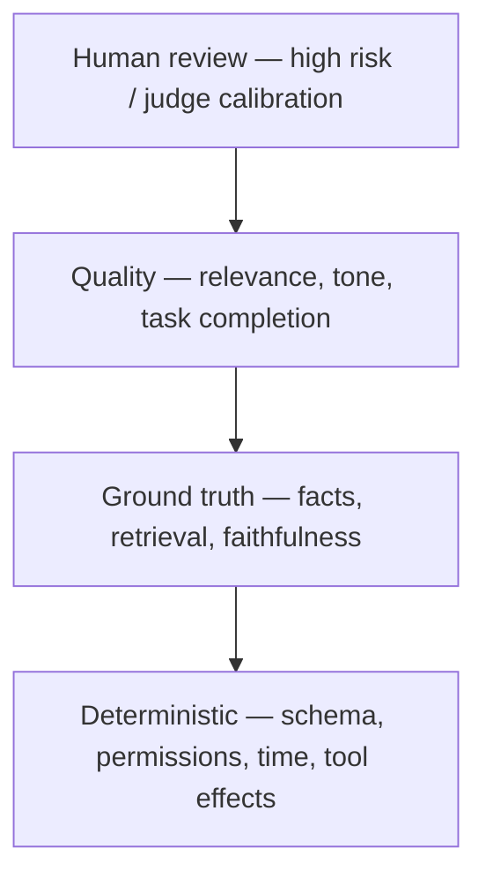

# AE-01 · Eval-Driven Development fundamentals (P1)

## Реалният казус

Conference assistant отговаря добре на три ръчни въпроса, после нов prompt нарушава schedule. Традиционните tests покриват service/repository, но не избор на tool, natural-language ambiguity, embeddings, context и multi-turn history. Лекция 04:50–09:05: uncertainty е в core на agent, не само по краищата. Традиционният software също има concurrency/failure nondeterminism; AI eval допълва, не заменя tests.

Goal: намира сесии, отговаря по event facts, записва само потвърдена лична програма. Non-goals: чужда програма, произволни действия, измислени venue facts. User personas: first-time attendee, JVM developer, agent developer. Дефинирай allowed actions и measurable success per journey.

Пирамидата е концептуална: повече евтини reliable checks в основата, targeted expensive graders нагоре. Ground truth може да се оценява с код или judge; human review не е автоматично абсолютна истина. Сравнявай candidate с baseline върху същите cases, model/config/data versions, per-slice резултат и uncertainty.

**Bad:** vibe testing + един среден score. **Good:** define success/failure, frozen dataset, hard checks + quality metrics, compare, investigate, deploy/canary, iterate. Score 0.95 не означава 95% вероятност за истина. Не използвай statistical eval за permissions, financial invariants или schema, ако кодът може да ги гарантира.

Decision: EDD при probabilistic behavior и model/prompt/tool changes; не добавяй LLM evaluator към deterministic CRUD. Печелим regression visibility; губим labeling, runtime, cost и риск от biased metric. Алтернатива: unit/integration + human review за малък deterministic продукт. Evidence: [Offline lab](lab/README.md), [Golden dataset](lab/src/test/resources/golden-v1.json); [existing AI-generated test guardrails](../../spring/testing/ai-assisted-testing/03-AI-GUARDRAILS.md). Checklist: task goals; what must never happen; independent oracle; versioned dataset; repeated trials; release and feedback owner.

## Оригинални източници

[Urs Peter — Eval Driven Development](https://www.youtube.com/watch?v=4qeUklTLyTs) · [Anthropic — Demystifying evals for AI agents](https://www.anthropic.com/research/demystifying-evals-for-ai-agents) · [OpenAI — Evaluation best practices](https://developers.openai.com/api/docs/guides/evaluation-best-practices) · [Evidence map](SOURCES-AND-EVIDENCE.md)
