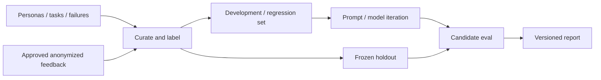

# AE-02 · Golden datasets & evaluation harness (P1)

## Казус

LLM генерира 100 paraphrases на happy-path FAQ. Всички минават, но няма unknown parking, malicious instruction, stale session, overlap или multi-turn. Dataset измерва само това, което съдържа.

Лекция 09:05–13:40: define goals/non-goals, personas, happy/rainy flows; AI може да предложи inputs, но човек ги преглежда; production examples обогатяват dataset. Наше допълнение: split по scenario families, frozen holdout, evidence provenance, mutation traces, no test leakage.

Dataset case: stable ID, split, risk/slice, input/turns, frozen clock, expected claims, relevant document IDs, required/forbidden tools + arguments, expected schedule/outcome, hard rules, provenance. Store expected independently of model trace; never derive expected from candidate. Annotator disagreement → review; ambiguous input expected clarification/abstention, not guessed facts. De-identify production traces, approval/retention; synthetic cases are not real customer data. Paraphrase variants of same case must stay same split.

[Golden dataset](lab/src/test/resources/golden-v1.json) contains curated synthetic cases; [Replay traces](lab/src/test/resources/replay-v1.json) separately stores observed fixture traces (good and deliberate defects). Test harness runs replay against fixed expectations, not a model. Holdout fixtures visible in repo are educational only; true hidden holdout requires separate controlled access and no prompt tuning on it.

Decision: use small diverse curated seed then expand failures; avoid giant unreviewed synthetic set. Gain reproducibility and comparable baseline; cost labeling, representativeness, drift. Simpler alternative: handful of parameterized JUnit cases for one deterministic contract. Evidence: [Offline lab](lab/README.md). Checklist: unique IDs; explicit split; independent expectations; negative controls; fixed time; version and source; no secrets; no leakage.

## Оригинални източници

[Urs Peter — Eval Driven Development](https://www.youtube.com/watch?v=4qeUklTLyTs) · [Dokimos datasets](https://dokimos.dev/evaluation/datasets/) · [Anthropic — Demystifying evals for AI agents](https://www.anthropic.com/research/demystifying-evals-for-ai-agents) · [OpenAI — Evaluation best practices](https://developers.openai.com/api/docs/guides/evaluation-best-practices) · [Evidence map](SOURCES-AND-EVIDENCE.md)
