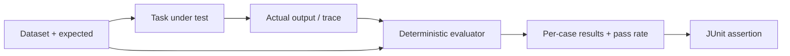

# AE-03 · Deterministic evals & Dokimos (P1)

## Казус

Agent returns polished schedule but adds two sessions that overlap. Judge likes wording. We can calculate overlap exactly using half-open intervals [start,end), compare actual tool arguments, schema, tenant and final state. A contains check is cheap but can be fooled by negation: "The venue is NOT Hall A" contains Hall A.

Лекция 13:40–18:15, 30:00–31:00: Dokimos JVM, dataset, task, evaluator, experiment/JUnit; start simple with contains; deterministic foundation. Нашият exact-match experiment uses structured venue label, not free-text "truth" proof.

Dokimos 0.31.0 pinned (published Nov 2026; not necessarily version on stage). `Dataset.builder`, `Example.of`, `Experiment.builder`, `ExactMatchEvaluator`; see [real offline Dokimos test](lab/src/test/java/bg/hristomanov/education/eval/DokimosOfflineTest.java). Use core test dependency, no server; Spring AI integration separate. [EvalChecks](lab/src/main/java/bg/hristomanov/education/eval/EvalChecks.java) verifies exact domain constraints from traces; schemas also need actual parser and validation at boundary. No requirement to use Dokimos if plain JUnit simpler; framework adds experiment reporting, adapters, typed cases, maintenance/version dependency. Do not evaluate a natural-language answer by exact match unless contract really is exact. Model output is not a trusted oracle.

Decision: deterministic first for known facts/structured fields/side effects, use calibrated judge only for semantic quality. Gain speed, repeatability; cost test fixtures and brittle matching for open text. Evidence: [test](lab/src/test/java/bg/hristomanov/education/eval/EvalHarnessTest.java), [Dokimos test](lab/src/test/java/bg/hristomanov/education/eval/DokimosOfflineTest.java). Checklist: hard rules explicit, negative controls, no hidden normalization, expected not generated by candidate, correct denominator.

## Оригинални източници

[Urs Peter — Eval Driven Development](https://www.youtube.com/watch?v=4qeUklTLyTs) · [Dokimos — official docs](https://dokimos.dev/) · [Dokimos setup](https://dokimos.dev/getting-started/installation/) · [Dokimos Spring AI integration](https://dokimos.dev/integrations/spring-ai/) · [Spring AI evaluation](https://docs.spring.io/spring-ai/reference/api/testing.html) · [Evidence map](SOURCES-AND-EVIDENCE.md)
