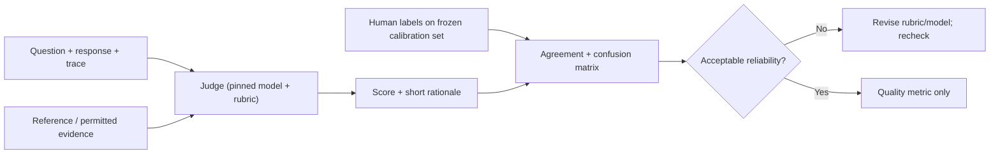

# AE-04 · LLM-as-a-Judge & calibration (P1)

## Казус

Conference assistant imitates pirate speech; desired tone is professional. In lecture (~18–23 min) judge scores 0.62, after prompt change 0.95. These are demo observations, not our benchmark. Judge is another probabilistic component; a more capable model is a candidate, not automatic truth.

Rubric: one dimension per grader where feasible; observable criteria and examples of pass/fail; no free-form guessing, treat submitted text as untrusted data (no tools/privileges). For pairwise comparisons randomize A/B and check reversed ordering; control verbosity; separate model under test and judge configuration. Position/verbosity/self-preference reported in research. Temperature 0 reduces some variability where supported, not determinism; pin dated model revision if provider supports it.

Calibration: run same frozen examples k times; mean and sample SD (n−1), threshold flips; compare to independently adjudicated human labels; TP/TN/FP/FN (positive = acceptable answer); false-pass rate = FP/(FP+TN); agreement = (TP+TN)/N. Report counts and disagreement, not just average. E.g. labels [pass,fail,pass,fail], judge [pass,pass,pass,fail] → 75% agreement, false-pass 1/2. All-pass grader on imbalanced set can look good; inspect negative slices. Calibrate on dedicated set, validate on holdout; human labels can disagree. [EvalMetrics](lab/src/main/java/bg/hristomanov/education/eval/EvalMetrics.java), [metrics tests](lab/src/test/java/bg/hristomanov/education/eval/EvalMetricsTest.java).

Decision: judge for subjective tone/helpfulness/semantic faithfulness; not for authorization, math, known exact field. Gain scalable grading; cost, latency, bias, judge injection and correlated errors. Alternative: rule-based checks + human sample. Lecture 31–32 min calibration; [Opt-in live experiment](live/README.md) uses real Spring AI model on tiny synthetic cases and reports observed agreement, not production readiness. Never silently drop malformed judge result; error/inconclusive must not count pass. Checklist: frozen rubric/model/data, calibration + holdout, false pass and variance, repeated trials, hard gate independent.

## Оригинални източници

[Urs Peter — Eval Driven Development](https://www.youtube.com/watch?v=4qeUklTLyTs) · [Zheng et al. — Judging LLM-as-a-Judge](https://arxiv.org/abs/2306.05685) · [OpenAI — Evaluation best practices](https://developers.openai.com/api/docs/guides/evaluation-best-practices) · [Dokimos Spring AI integration](https://dokimos.dev/integrations/spring-ai/) · [Evidence map](SOURCES-AND-EVIDENCE.md)
