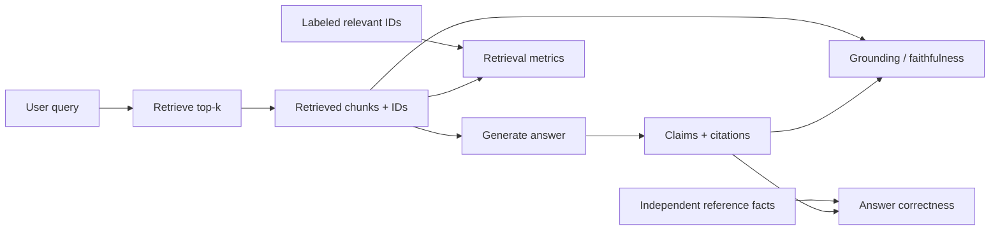

# AE-05 · RAG evaluation & hallucination diagnosis (P1)

## Казус

Agent calls event-info tool about parking; context contains venue but no parking information. It claims ample parking. The real world might happen to agree, but answer is unsupported by permitted context. Lecture 23:15–28:10: evaluate vector search, ground truth, claims vs truths, faithfulness/hallucination, tool recorder.

With known set of relevant document IDs G and deduplicated retrieved IDs R: set precision=|R∩G|/|R|; recall=|R∩G|/|G|. R=[java,noise], G=[java,loom] gives 0.5/0.5. Empty denominator undefined, not perfect 1; use explicit no-relevant/abstention case. Rank-sensitive precision@k, MRR/nDCG answer different questions (ranking); LLM contextual relevance/precision evaluator definitions vary. Do not mix scores across implementations. [EvalMetrics](lab/src/main/java/bg/hristomanov/education/eval/EvalMetrics.java) uses set formulas, not ranked or LLM RAG metric.

Faithfulness: claims supported by retrieved context; correctness: independent truth (context can be wrong or stale); relevance: responds to intent; completeness: required facts present. High faithfulness with stale source ≠ correct. For synthetic structured claims, verify each claim ID is in authorized evidence and exact expected facts; free-text extraction and entailment need human/calibrated model, no invented NLP inference in our harness. Unknown parking must abstain after lookup. [EvalChecks](lab/src/main/java/bg/hristomanov/education/eval/EvalChecks.java) and replay cases. Diagnose retrieval missing relevant docs (chunking/embedding/filter); retrieved correct facts but unsupported claim (generation); wrong/stale source (data quality); tool missing/failed (trajectory).

Decision: evaluate retrieval and generation separately for RAG; avoid using judge if exact labeled IDs/facts suffice. Gain diagnosis; cost labeled corpus, evolving index and subjective grading. Alternative: authoritative structured lookup. Evidence: [Golden dataset](lab/src/test/resources/golden-v1.json), [Replay traces](lab/src/test/resources/replay-v1.json), [tests](lab/src/test/java/bg/hristomanov/education/eval/EvalHarnessTest.java). Checklist: frozen corpus and versions; top-k; relevant IDs; unsupported vs false; unknown/no answer; source attribution; no fake citations. Full RAG design/embeddings is future curriculum, not implemented here.

## Оригинални източници

[Urs Peter — Eval Driven Development](https://www.youtube.com/watch?v=4qeUklTLyTs) · [Spring AI evaluation](https://docs.spring.io/spring-ai/reference/api/testing.html) · [Anthropic — Demystifying evals for AI agents](https://www.anthropic.com/research/demystifying-evals-for-ai-agents) · [Dokimos — official docs](https://dokimos.dev/) · [Evidence map](SOURCES-AND-EVIDENCE.md)
