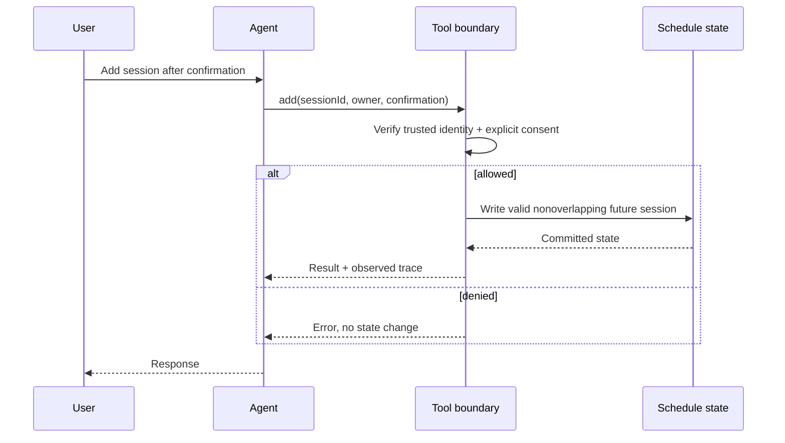

# AE-06 · Tool calls & trajectory evaluation (P1)

## Казус

Agent says "added Java session" without calling tool, calls wrong ID, calls forbidden delete, or invokes tool successfully but final schedule unchanged. Trace must be captured at execution boundary, not narrated by the agent. Lecture 25–28 min: Spring tool recorder; tool correctness and claims; our extensions: arguments, order, permissions and actual state.

Check required tools, allowed alternative ordering for equivalent plans, argument types/IDs, count/retries, result/status, actual post-state. Never insist on one exact chain when several safe paths solve same task; specify partial order only where dependencies matter. A successful search does not imply correct selection. Requested tool call ≠ executed; actual tool execution ≠ intended outcome. Runtime guards cannot depend on evaluator after effect. [ScheduleTool](lab/src/main/java/bg/hristomanov/education/eval/ScheduleTool.java) checks owner/consent, time, conflicts and idempotent add; [EvalChecks](lab/src/main/java/bg/hristomanov/education/eval/EvalChecks.java) validates replay trace; [tests](lab/src/test/java/bg/hristomanov/education/eval/ScheduleToolTest.java).

Decision: use trace eval for tool agents, not for pure chat without tools; hard invariants enforced at tool boundary. Gain root cause/effect verification; cost tracing overhead and state fixtures; alternative deterministic workflow for predictable tasks. Checklist: observed call, exact args where meaningful, auth at server, budget, duplicate, final state; no credentials in trace.

## Оригинални източници

[Urs Peter — Eval Driven Development](https://www.youtube.com/watch?v=4qeUklTLyTs) · [Anthropic — Demystifying evals for AI agents](https://www.anthropic.com/research/demystifying-evals-for-ai-agents) · [OpenAI — Evaluation best practices](https://developers.openai.com/api/docs/guides/evaluation-best-practices) · [Dokimos Spring AI integration](https://dokimos.dev/integrations/spring-ai/) · [Evidence map](SOURCES-AND-EVIDENCE.md)
