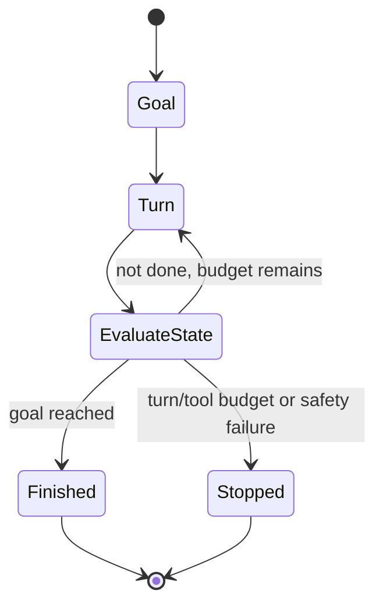

# AE-07 · Multi-turn conversations & trajectory (P1)

## Казус

Single-turn query finds Java sessions correctly; after several turns agent forgets previous bookings/preferences and proposes overlaps. Lecture 28–31 min: simulated persona with goal, same conversation ID, max turns and stop condition, trajectory graders + deterministic overlapping-session rule. High conversation score did not prevent overlap.

Model conversation simulator can generate plausible inputs but also creates another source of nondeterminism. Start with scripted turns and explicit state snapshots; use live simulation only for exploratory coverage with maxTurns, maxCalls, deadline, stop conditions, tool sandbox. Separate conversation IDs and authenticated principals, not memory as auth. Test changing mind, cancellation, clarification, conflicting constraints, stale date and cross-session isolation. Schedule intervals half-open [start,end), adjacent sessions valid, overlapping not; fixed clock includes timezone; session start equal to now permitted in this lab, past not. Task success measured against final persisted schedule, not judge's impression.

Decision: multi-turn when outcome requires state/history; avoid costly simulation for stateless FAQ. Gain stateful coverage, cost many model calls and more flakiness. Alternative: scripted trajectory replay; [Replay traces](lab/src/test/resources/replay-v1.json), [ScheduleTool](lab/src/main/java/bg/hristomanov/education/eval/ScheduleTool.java), [tests](lab/src/test/java/bg/hristomanov/education/eval/ScheduleToolTest.java). Checklist: same conversation within test, separate across tests, turns bounded, final state, adversarial step, missing context clarified. Live conversation simulator integration remains extension; offline lab tests stored traces and runtime schedule rules, not a real agent conversation.

## Оригинални източници

[Urs Peter — Eval Driven Development](https://www.youtube.com/watch?v=4qeUklTLyTs) · [Anthropic — Demystifying evals for AI agents](https://www.anthropic.com/research/demystifying-evals-for-ai-agents) · [Dokimos — official docs](https://dokimos.dev/) · [Evidence map](SOURCES-AND-EVIDENCE.md)
