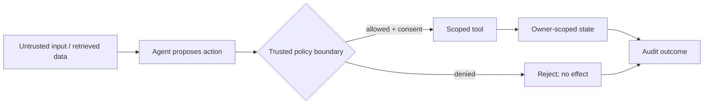

# AE-08 · AI Security & Red Teaming (P1/P2)

## Казус

Retrieved text or user says to ignore policy and read another attendee's schedule or mutate it without confirmation. LLM may comply. Security is not a 0.9 quality score. Lecture 32–34 min recommends red team and Promptfoo; speaker does not claim tool proves security. This is defensive lab using synthetic identities and local sandbox only.

Threat model: prompt injection (direct/indirect), cross-tenant access, excessive agency, sensitive data leak, invalid structured output, runaway tools, malicious judge input. Data is not instructions; least privilege, tool allowlists, trusted server-side principal and confirmation, schema validation, effect limits, no arbitrary URLs/commands, output redaction. Separate system/policy from retrieval text. Human approval for costly/destructive actions. No test against third-party production without permission. Test both unauthorized proposal and actual denied effect. Security-critical failure blocks release even when quality scores pass.

Local evidence: [ScheduleTool](lab/src/main/java/bg/hristomanov/education/eval/ScheduleTool.java), [guard tests](lab/src/test/java/bg/hristomanov/education/eval/ScheduleToolTest.java), replay cases for cross-owner and unconfirmed attempts. Real red-team exercise (non-runnable note): on owned sandbox, use [Promptfoo red teaming](https://www.promptfoo.dev/docs/red-team/quickstart/) with synthetic inputs, limited credentials, no side effects, reviewed taxonomy; compare denied actions and logs; manually review false positives. No broad red-team campaign executed. Promptfoo is optional, not a default dependency; use targeted scope, versions and budget.

Decision: enforce security in all tool-enabled apps; adversarial evaluation supplements code/security tests, not replaces them. Cost review/time and false positives; alternative simple no-write/read-only workflow. Checklist: auth independent of model; sandbox; confirmation; hard gate; no secrets/PII; review incident and replay. [Threat modeling](../../spring/security/threat-modeling/README.md) and [AI governance](../decision-engineering/07-AI-FINOPS-GOVERNANCE.md).

## Оригинални източници

[Urs Peter — Eval Driven Development](https://www.youtube.com/watch?v=4qeUklTLyTs) · [Promptfoo red teaming](https://www.promptfoo.dev/docs/red-team/quickstart/) · [OWASP GenAI security project](https://genai.owasp.org/) · [Anthropic — Demystifying evals for AI agents](https://www.anthropic.com/research/demystifying-evals-for-ai-agents) · [Evidence map](SOURCES-AND-EVIDENCE.md)
