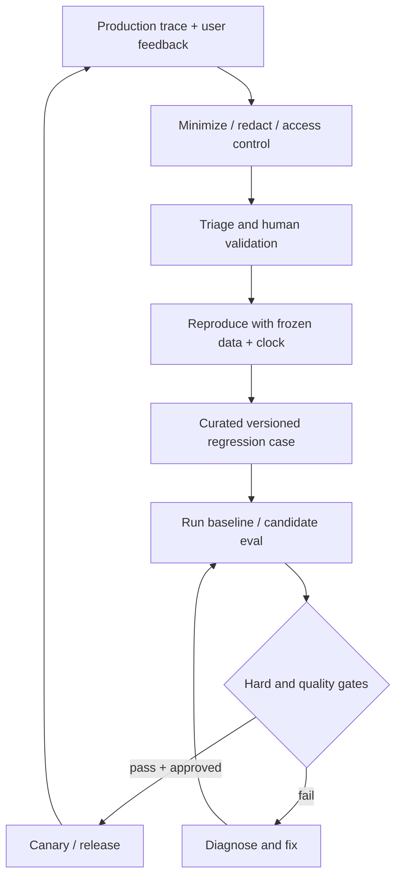

# AE-09 · Production observability & feedback (P1)

## Казус

User asks for sessions still possible to attend; assistant returns past talks. Lecture 34–39 min: Langfuse/OTel trace and feedback, triage notebook, reproduce bad-rated trace and add custom past-session regression. A triage model's 96% confidence in demo is not verified probability.

Trace ID, model/prompt/retrieval versions, tool name/redacted args/result status, duration, usage/tokens/cost, finish reason, retrieval IDs/versions, conversation ID (pseudonym), outcome and feedback. Capture span boundaries, not hidden reasoning; minimize raw prompts/responses, no secrets, retention/consent/access rules, sample cost and privacy. Use OTel + approved backend such as Langfuse. Monitor latency/error, token usage, guard denials, task success per slice, judge disagreement and coverage. Feedback is selection-biased; sample random and high-risk conversations; don't turn every complaint into correct label. Reproduce with fixed event time and policy, independent source; deduplicate by family and keep holdout untouched.

[Golden dataset](lab/src/test/resources/golden-v1.json) and [Replay traces](lab/src/test/resources/replay-v1.json) include past-session negative regression (synthetic reconstruction, not actual production trace). Review task: triage complaint, classify retrieval/time-filter/generation/tool issue, choose owner, create case, prove bad replay fails, rerun, audit. No actual Langfuse deployment or production ingestion in this module; [OpenTelemetry lab](../../spring/observability/otel-agent-demo/README.md) for instrumentation. No auto-upload of customer data.

Decision: continuous production sampling for real use, not full indiscriminate content logging. Gain detection of unseen failures; cost storage/privacy/labeling. Alternative minimal metadata plus reviewed sampled cases. Checklist: trace and outcome linked; data minimization; feedback verified; time/version frozen; case source; owner; retention; rollback.

## Оригинални източници

[Urs Peter — Eval Driven Development](https://www.youtube.com/watch?v=4qeUklTLyTs) · [Langfuse evaluation](https://langfuse.com/docs/evaluation/overview) · [OpenTelemetry documentation](https://opentelemetry.io/docs/) · [Anthropic — Demystifying evals for AI agents](https://www.anthropic.com/research/demystifying-evals-for-ai-agents) · [Evidence map](SOURCES-AND-EVIDENCE.md)
