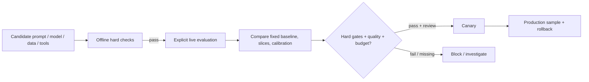

# AE-10 · Continuous evaluation, CI/CD & cost control (P1)

## Казус

Changing model or prompt improves mean quality but introduces unauthorized write in one rare case. Average hides critical defect. CI should distinguish default deterministic tests, scheduled/opt-in model eval and production sampling. Lecture 28–32, 36–40 min: costly repeated calls, calibration, continuously grow golden dataset; statistical methods below are extensions.

Per trial pass, per-case all-pass and at-least-one-pass: pass@k vs pass^k (for independent identical success p: 1−(1−p)^k vs p^k; actual correlated trials require empirical measurement). If p=.75,k=3, 98.4375% any vs 42.1875% all. Dataset coverage and repeated runs matter, report denominators, errors, confidence intervals and slice sizes; repeated trials of same case not independent observations. Compare paired same cases and configurations; no claims from tiny samples. Quality threshold not a probability. Pin evaluator, model, prompt, retrieval corpus, tool version, clock; errors/missing cases are failures/inconclusive, not omitted. Regression gate: each required case must have result; hard failures always block, per-slice threshold and baseline tolerance; minimum sample; budget; review. [ReleaseGate](lab/src/main/java/bg/hristomanov/education/eval/ReleaseGate.java), [gate tests](lab/src/test/java/bg/hristomanov/education/eval/ReleaseGateTest.java).

Cost example (hypothetical): 100 cases × 3 trials × (1 agent + 2 judge calls) = 900 calls before extra tool/simulation/retries. Track tokens input/output per model, latency, cost per accepted task; cap cases/turns/calls/tokens/time. Prefer deterministic evaluator, cache only with versioned context, sample expensive judge. Never silently retry until pass. Default Maven reactor runs replay/JUnit and actual Dokimos deterministic evaluator. [Opt-in live experiment](live/README.md) only opt-in, fixed synthetic cases, no auto retry; external credentials and explicit model names required. Real live CI should use approved budgets, secret protection and manual/scheduled workflow, not run for public fork PR. No API keys in repo. Provider APIs change: OpenAI's old Evals platform is deprecated as of review date; we use generic principles, not bind course to retired platform.

Decision: continuous eval when model/prompt/data evolves; don't run costly live suite every commit if replay covers changes; high-risk release requires representative live evidence and human review. Gain early detection; cost CI minutes/tokens/false alarms. Alternative targeted smoke + scheduled sample. Checklist: hard rules; fixed dataset; per-slice counts; fail closed; budget and stop; no test leakage; owner and rollback.

## Оригинални източници

[Urs Peter — Eval Driven Development](https://www.youtube.com/watch?v=4qeUklTLyTs) · [Anthropic — Demystifying evals for AI agents](https://www.anthropic.com/research/demystifying-evals-for-ai-agents) · [OpenAI — Evaluation best practices](https://developers.openai.com/api/docs/guides/evaluation-best-practices) · [Langfuse evaluation](https://langfuse.com/docs/evaluation/overview) · [Evidence map](SOURCES-AND-EVIDENCE.md)
