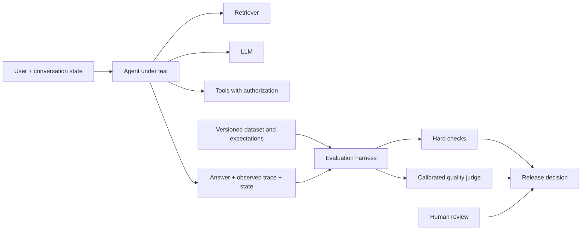

# AI Evaluation — Eval-Driven Development for Production Agents

> P1 · Java/Spring AI · по [Urs Peter — Eval Driven Development](https://www.youtube.com/watch?v=4qeUklTLyTs). Прегледан предоставен auto-generated SRT (40:xx min); нашият синтетичен conference case, code, diagrams и dataset са адаптация, не оригиналният агент на автора.

## Вход: conference assistant

Потребител търси бъдещи Java/concurrency лекции и иска лична програма. Агентът има LLM, history, vector retrieval, event-information tool, schedule tools. Красивият отговор може да предлага минала сесия, да измисля паркинг или да записва две застъпващи се лекции. Demo green ≠ correctness. Трябва да оценим не само текста, а **retrieval, trace, authorized side effects и крайното състояние**.

Не използваме judge за бизнес инвариант, който може да се провери с код. Традиционните unit/integration/security tests остават. Offline eval върху dataset означава pre-production оценка, но може да извиква модел; нашият default lab е изцяло без LLM заявки (trace replay). Отделният live module изпълнява реален модел само при изрично стартиране.

## Учебен ред

| ID | Глава | Evidence |
| --- | --- | --- |
| AE-01 | [EDD fundamentals](01-EVAL-DRIVEN-DEVELOPMENT.md) | Goals, non-goals, evaluation pyramid |
| AE-02 | [Golden datasets & harness](02-GOLDEN-DATASETS.md) | JSON fixture, split, independent expectations |
| AE-03 | [Deterministic evals & Dokimos](03-DETERMINISTIC-DOKIMOS.md) | JUnit + real Dokimos exact match |
| AE-04 | [LLM-as-a-Judge & calibration](04-LLM-JUDGE-CALIBRATION.md) | Repeatability / agreement metrics; opt-in judge |
| AE-05 | [RAG evaluation](05-RAG-EVALUATION.md) | Set precision/recall, evidence and abstention fixtures |
| AE-06 | [Tool calls & trajectory](06-TOOL-TRAJECTORY.md) | Tool args, effect, authorization and ordering |
| AE-07 | [Multi-turn conversations](07-MULTI-TURN.md) | Schedule invariants, bounded turns, isolated state |
| AE-08 | [Security & red teaming](08-SECURITY-RED-TEAMING.md) | Deny unauthorized mutation; security worksheet |
| AE-09 | [Observability & feedback](09-PRODUCTION-FEEDBACK.md) | Triage → dataset; past-session regression |
| AE-10 | [Continuous eval & cost](10-CONTINUOUS-EVAL.md) | Slice release gate, trials, budget; manual/live policy |

## README → code

[EvalModel](lab/src/main/java/bg/hristomanov/education/eval/EvalModel.java) · [EvalChecks](lab/src/main/java/bg/hristomanov/education/eval/EvalChecks.java) · [EvalMetrics](lab/src/main/java/bg/hristomanov/education/eval/EvalMetrics.java) · [ScheduleTool](lab/src/main/java/bg/hristomanov/education/eval/ScheduleTool.java) · [ReleaseGate](lab/src/main/java/bg/hristomanov/education/eval/ReleaseGate.java) · [Golden dataset](lab/src/test/resources/golden-v1.json) · [Replay traces](lab/src/test/resources/replay-v1.json).

[Offline lab](lab/README.md) — Java 25, JUnit, Dokimos 0.31.0 (без API ключ). [Opt-in live experiment](live/README.md) — отделен Maven module/profile, Spring AI, реални платени заявки само по избор. [Exercises](EXERCISES.md) · [NotebookLM audio](NOTEBOOKLM-PROMPT.md) · [Sources and evidence](SOURCES-AND-EVIDENCE.md).

## Изход

След модула можеш да дефинираш agent success, да откриеш retrieval vs generation vs tool failure, да провериш крайното състояние независимо от отговора, да калибрираш judge и да поставиш release gate. High score не отменя security/business failure. Локалните тестове доказват harness и конкретни fixtures, не качеството на production модел. Не оценяваме личното обучение само по merged файлове.

## Оригинални източници

[Urs Peter — Eval Driven Development](https://www.youtube.com/watch?v=4qeUklTLyTs) · [Dokimos — official docs](https://dokimos.dev/) · [Anthropic — Demystifying evals for AI agents](https://www.anthropic.com/research/demystifying-evals-for-ai-agents) · [OpenAI — Evaluation best practices](https://developers.openai.com/api/docs/guides/evaluation-best-practices) · [Evidence map](SOURCES-AND-EVIDENCE.md)
