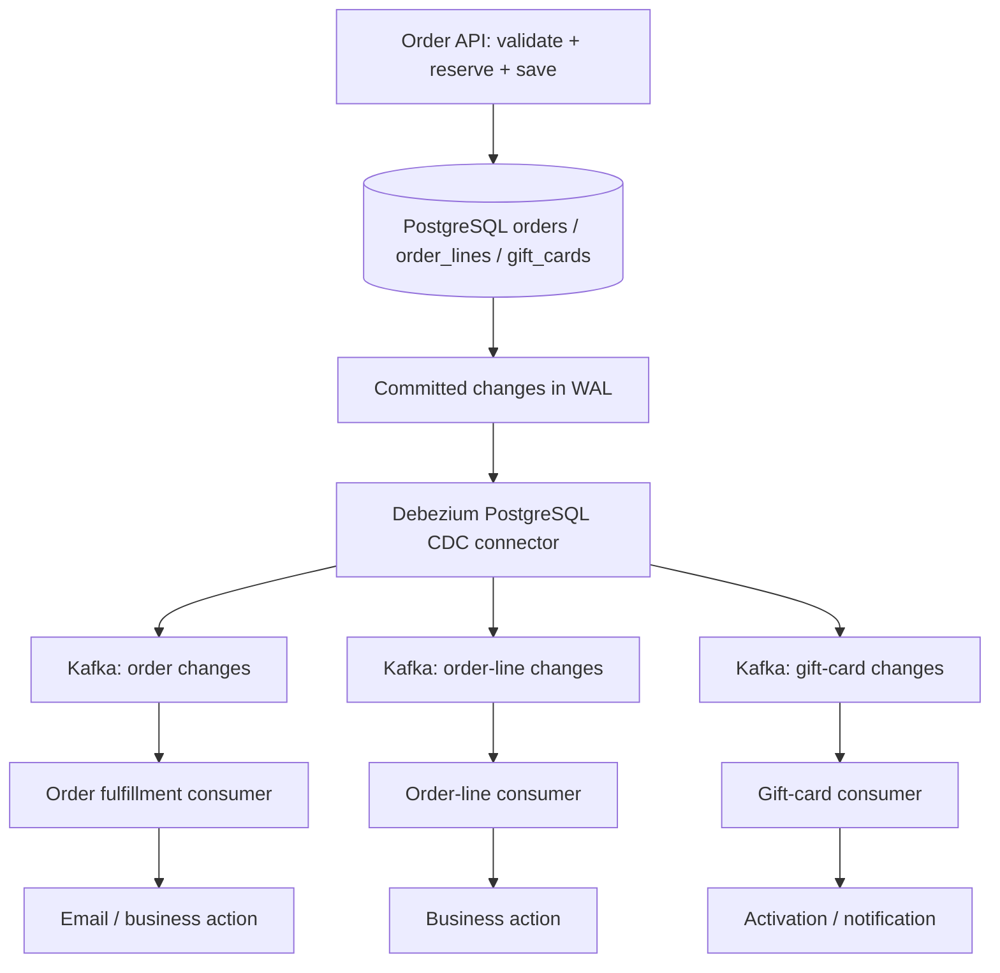

# Case Study 001 — Decathlon: отказ от директно Kafka publish в Order API

> **Тип:** реален production инженерeн казус (документация, не изпълнима лаборатория)  
> **Източник:** Devoxx, Virginie Zinck, *The day we stopped publishing Kafka event from our API*, публикувано на 2026-10-06 (≈30 мин).  
> **Теми:** Kafka, PostgreSQL, Debezium, CDC, dual write, transactional outbox, idempotency, WAL, replication slots, observability.  
> **Приоритет:** P1 — System Design / Distributed Systems / Reliability. Полезно и при P0 — Messaging/Transactions.  
> **Статус:** документиран по транскрипцията и официална документация; архитектурата на Decathlon **не е възпроизведена и не е тествана** в нашето репо.

## Защо пазим този казус

Не е просто лекция „какво е Outbox“. Тя проследява реален production проблем:

1. API записва бизнес състояние в релационна база и отделно изпраща Kafka message.
2. Двете операции могат да се разминават — *dual-write problem*.
3. Екипът разглежда няколко решения, но **избира CDC върху съществуващите бизнес таблици, а не отделна outbox таблица**.
4. Новата архитектура решава първоначалните проблеми, но въвежда друг риск: replication slot може да задържа PostgreSQL WAL до изчерпване на дисковото пространство.
5. За надеждна работа са необходими **heartbeats + наблюдение на connector/replication slot/WAL**, а не само проверка дали API работи.

**Mental model:** надеждната архитектура не премахва failure modes — тя премества границите и изисква нови механизми за наблюдение и възстановяване.

## 1. Контекст: Order API за подаръчни карти

Екипът на Decathlon обслужва поръчки с gift cards, включително големи B2B поръчки с хиляди карти.

Синхронно в Order API:
- валидира заявката;
- проверява и резервира наличността;
- записва поръчката в PostgreSQL.

Асинхронно:
- активира подаръчните карти;
- изпраща имейли;
- обновява клиентския wallet, когато е приложимо.

Първоначалният API **изпраща директно Kafka съобщения** за асинхронните действия, докато обработва и DB транзакцията.

### Двата инцидентни сценария

**A. Message before failed DB commit**

```text
API → Kafka: ActivateGiftCard / SendEmail
API → PostgreSQL: INSERT order
PostgreSQL: ROLLBACK (например constraint violation)

Kafka consumer: получава команда за поръчка, която не съществува
```

**B. Consumer reads before commit**

```text
API → Kafka: SendEmail(orderId)
consumer: получава event и чете PostgreSQL → order not found
API: COMMIT няколко милисекунди по-късно
```

В лекцията вторият сценарий е описан като по-често срещан при големи B2B поръчки.

### Защо очевидните fixes не са достатъчни

| Опит | Защо изглежда разумен | Защо не решава проблема |
| --- | --- | --- |
| Публикуване на compensating Kafka message | „Ако rollback-не DB, ще върнем активирането“ | Не всеки side effect се отменя (напр. вече изпратен email); compensation може също да се провали |
| Kafka consumer retries | Изчакваме малко, докато поръчката се появи | При реален DB rollback тя никога няма да се появи |
| Първо DB commit, после Kafka publish | Премахва „consumer before commit“ | Crash/network failure между commit и publish: order съществува, съобщението липсва |

**Root cause:** няма една обикновена local transaction, която да commit-не атомарно PostgreSQL данните и произволен Kafka publish.

## 2. Разгледаните варианти

| Вариант | Предимство | Цена/ограничение | Избран? |
| --- | --- | --- | --- |
| Kafka first → consumer записва Order в DB | Kafka става първичната входна точка; няма непосредствен DB+Kafka dual write в API | Order не е налична за незабавен прочит при consumer lag; неподходящо за UX на поръчките им | Не |
| **Класически Transactional Outbox**: Order + Outbox event в един DB commit; relay/CDC към Kafka | Ясен, стабилен event contract; event ID; durable intent to publish | Допълнителна таблица, cleanup, relay/CDC инфраструктура | Не |
| **`pg_logical_emit_message(true, ...)`** в същата PostgreSQL транзакция; logical decoding към Kafka | Без outbox таблица и cleanup | PostgreSQL-specific; нужни съвместим logical decoding/connector, explicit event contract и операции | Не |
| **CDC върху business tables** (`orders`, `order_lines`, `gift_cards`) | Без outbox таблица; API не знае fulfillment действията; лесно добавяне на consumers | Събитията са технически row changes, не изрични integration events; schema/version/dedup/ordering са по-трудни | **Да** |

**Точно разграничение:** авторката го представя като „outbox variant“, но технически избраното решение е **business-table CDC**. То постига publish-after-commit поведение за row changes, но **не гарантира, че съществува explicit domain/integration event** със стабилен договор. Не бива да се използва като пълен синоним на Transactional Outbox.

## 3. Избраната архитектура



**Последователност:**
1. API прави бизнес промените в PostgreSQL и приключва транзакцията.
2. Промените от **committed transactions** стават видими за logical decoding.
3. Debezium чете WAL и изпраща CDC records към Kafka, по topic за всяка наблюдавана таблица.
4. Consumers решават кои промени означават действие. Например `CREATED → VALIDATED` може да задейства email.
5. По-късно се добавя нов consumer (напр. invoice или SMS), без непременно да се променя Order API.

Авторката отчита: премахнати първоначални inconsistencies, опростен API, по-добра разширяемост и централизирана в consumers обработка на retries/DLT.

**Какво НЕ се гарантира:** event delivery не става магически exactly once, а external side effects като email/SMS/payment все още могат да се дублират или да изискват recovery.

## 4. Важните компромиси (наш инженерeн анализ)

### 4.1 CDC record ≠ domain event

Промяна на ред в `orders` може да е:
- валиден business transition;
- технически update без бизнес значение;
- миграция/корекция на данни;
- snapshot record при bootstrap/resnapshot.

Consumer-ът трябва да интерпретира `op` (create/update/delete/read), before/after, бизнес статус и бизнес версия. Не изпращай имейл за **всеки update** и не третирай snapshot като нова поръчка.

### 4.2 Idempotency не е равна на `order_id`

За една поръчка може да има `v1 CREATE`, `v2 VALIDATE`, `v3 UPDATE`. Ако dedupe ключът е само `order_id`, ще блокираме легитимни последващи обработки.

Кандидат за identity: `consumer_action + aggregate_id + business_version/transition_id`, когато source моделът поддържа надеждна и монотонна версия. Трябва да е стабилна при replay, но различна за ново бизнес действие.

За външен email/SMS ефект „запиши processed → изпрати“ рискува загуба при crash, а „изпрати → запиши processed“ рискува повторно изпращане. Използвай outbox/durable delivery state и idempotency-key при provider, ако е наличен; иначе приеми и обработвай риска изрично.

### 4.3 Ordering и transaction boundaries

Kafka гарантира ред **в рамките на partition**, а не между три отделни topics. При промяна на `orders`, `order_lines` и `gift_cards` в една DB транзакция consumers по различни topics могат да видят/обработят промените в различен момент.

Пази бизнес invariant-ите чрез explicit readiness/validated state, версии, re-read или orchestration, а не чрез предположение за cross-topic ordering.

### 4.4 Schema coupling и съвместимост

Смяна на колона/тип/структура в `orders` може да промени CDC schema и да счупи downstream consumer. Изисква schema evolution стратегия, versioning и contract tests; особено рисковано е, ако topic-ите се ползват от други екипи.

### 4.5 Защо classic Outbox може да е по-подходящ

Когато имаме публичен integration contract, външни потребители или complex business events, често е по-добре да запишем **explicit event** в transactional outbox и да го публикуваме чрез CDC или polling. При него business intent е видим и schema на DB таблица не става директно message contract.

## 5. Големият production риск: WAL retention

PostgreSQL Write-Ahead Log (WAL) съдържа записи за промените. Debezium чете чрез logical decoding и replication slot. Slot-ът съхранява информация докъде потребителят е потвърдил обработка и какъв най-стар WAL може още да е необходим.

Когато connector:
- е спрял/paused/crashed;
- или не може да потвърждава напредък при нисък captured traffic спрямо общия WAL activity,

`restart_lsn` може да изостане, а PostgreSQL **задържа** нужните WAL сегменти. Ако няма адекватни ограничения и наблюдение, `pg_wal` може да изчерпи диска и да засегне цялата база.

**Важно уточнение спрямо опростения разказ във видеото:** PostgreSQL не изтрива логовете „точно преди последния offset“ всяка минута. WAL се пази и освобождава по сегменти, при checkpoints и според множество retention ограничения — replication slots, archiving, backup и др. Heartbeat намалява риска от застой, но не гарантира фиксиран едноминутен размер на WAL.

### Два сценария → две различни защити

| Failure mode | Защита |
| --- | --- |
| Connector е жив, но captured changes са много редки и offset/LSN не напредва | Heartbeat + при нужда DB-side heartbeat action |
| Connector е спрял или Kafka Connect task има грешка | Alerting + operational recovery; heartbeat сам не може да оправи спрял процес |

## 6. Heartbeat: концептуална конфигурация за PostgreSQL

**Илюстративен пример — не копирай сляпо в production; тествай срещу конкретните PostgreSQL/Debezium версии и publication setup.**

В source базата:

```sql
CREATE TABLE public.debezium_heartbeat (
    id integer PRIMARY KEY,
    touched_at timestamptz NOT NULL
);

INSERT INTO public.debezium_heartbeat (id, touched_at)
VALUES (1, clock_timestamp())
ON CONFLICT (id) DO NOTHING;
```

Идеята на connector configuration:

```properties
heartbeat.interval.ms=60000
heartbeat.action.query=UPDATE public.debezium_heartbeat SET touched_at = clock_timestamp() WHERE id = 1
table.include.list=public.orders,public.order_lines,public.gift_cards,public.debezium_heartbeat
```

Допълнително: heartbeat таблицата трябва да присъства в **PostgreSQL publication** (ако е filtered, добави я изрично). Проверявай и topic routing/permissions, че heartbeat record действително се вижда.

Разликата между двете настройки е важна:
- `heartbeat.interval.ms` — Debezium изпраща periodic heartbeat signals.
- `heartbeat.action.query` — осигурява DB промяна, която може да бъде записана в WAL и уловена чрез logical decoding, особено при low-traffic tracked tables/database.

Не всяка инсталация има нужда от еднаква heartbeat конфигурация: решението зависи от traffic profile, PostgreSQL publication и connector settings. В лекцията авторката препоръчва heartbeat за всички техни connectors.

## 7. Как да го наблюдаваме

**Наблюдавай едновременно:**
- Kafka Connect connector и task state (RUNNING/FAILED/PAUSED);
- heartbeat topic rate/age (в лекцията: очаквана една heartbeat публикация на минута);
- Debezium source lag и progress;
- PostgreSQL slot `active`, `restart_lsn`, `confirmed_flush_lsn` и `wal_status`;
- bytes на WAL, които съответният slot още задържа;
- free disk space и trend/time-to-full;
- consumer lag/DLT/errors.

Read-only diagnostic SQL за PostgreSQL (при наличие на необходимите права):

```sql
SELECT
    slot_name,
    slot_type,
    active,
    restart_lsn,
    confirmed_flush_lsn,
    wal_status,
    pg_size_pretty(
        pg_wal_lsn_diff(pg_current_wal_lsn(), restart_lsn)::bigint
    ) AS potentially_retained_wal
FROM pg_replication_slots
WHERE slot_type = 'logical';
```

`potentially_retained_wal` е **оценка по LSN разлика**, не точен размер на файловете, за които единствено този slot е отговорен. За реална инцидентна диагностика сравни стойностите във времето и огледай останалите retention фактори.

Операционни предупреждения:
- Ако heartbeat topic няма очаквани записи за няколко последователни интервала, провери connector-а; не разчитай само на този сигнал.
- Ако `restart_lsn` застоява, а WAL расте, реагирай **преди** свободното място да се изчерпи.
- `max_slot_wal_keep_size` ограничава задържането на WAL за replication slot (default `-1` = няма зададен лимит), но при прескачане на лимита slot-ът може да изгуби необходимите WAL и да изисква възстановяване/resnapshot. **Не е безплатна защита.**

## 8. Incident playbook: Debezium забавя или задържа WAL

1. **Identify:** кой replication slot не напредва? Какъв е `active` статусът? Колко бързо расте `pg_wal`?
2. **Correlate:** Kafka Connect worker/task errors, мрежа, broker ACL/topic availability, connector heartbeat, PostgreSQL logs.
3. **Restore safely:** възстанови connector след отстраняване на причината; потвърди, че `confirmed_flush_lsn` и `restart_lsn` напредват и retention намалява постепенно.
4. **Do not blindly drop the slot:** това може да прекъсне CDC continuity и да наложи backfill/resnapshot. При invalidated slot възстанови състоянието по предварително планирана процедура.
5. **Verify:** no lost business changes, consumer reprocessing/idempotency, свободно място, alerts, downstream errors.
6. **Prevent recurrence:** heartbeat setup, alerts по WAL age/bytes + connector state + Kafka throughput, съгласуван retention/recovery plan.

## 9. Кога да използваме този подход

**Добър кандидат:** PostgreSQL е source of truth, business tables имат ясни state transitions, consumers са под наш контрол, приемаме CDC infrastructure и имаме дисциплина за schema/version/monitoring.

**По-добре classic Outbox:** когато integration events са публичен или дългоживеещ contract, изисква се event ID/payload/version independent of schema, downstream eкипите са независими, или row updates не отразяват еднозначно бизнес намерение.

**По-просто решение:** при умерено натоварване и липса на CDC инфраструктура polling outbox може да е достатъчен. По-малко компоненти често означава по-малка operational цена, срещу latency/polling компромиси.

**Не прави Kafka-first persistence само защото е технически удобно**, когато продуктовото изискване е потребителят веднага да вижда новата си поръчка.

## 10. Практически упражнения / проверка

Тези тестове **не са реализирани** за този case study; записани са като идеи за бъдеща Java 25 / Spring Boot / Testcontainers лаборатория.

1. Изпрати директен Kafka event преди DB commit и предизвикай rollback → consumer вижда несъществуваща поръчка.
2. CDC вариант: DB rollback → **не** се публикува committed row-change event; commit → event се появява eventual.
3. Replay на една `VALIDATED` промяна два пъти → само един business effect; следващата бизнес версия се обработва коректно.
4. Snapshot/backfill на стари редове → **без** изпращане на стари имейли.
5. Спри Debezium task-а, генерирай WAL, измери slot lag/retention; стартирай отново и провери recovery.
6. Промени DB schema, без да променяш consumer → contract test демонстрира рисковете.
7. Обнови `orders` и `gift_cards` в една DB транзакция, но консумирай от два topics → провери, че приложение не разчита на глобално подреждане.

**Съществуваща изпълнима основа:** [Transactional Outbox + Idempotent Consumer / Inbox](../../spring/messaging/outbox-inbox/README.md) — демонстрира dual-write, атомарен outbox и idempotent consumers с код/тестове, но **не** възпроизвежда Decathlon CDC deployment.

## 11. Quick retrieval card

**Симптом:** „Consumer обработи събитие, а транзакцията още не е commit-ната / rollback-на е.“  
**Механизъм:** DB+Kafka dual write — няма общ atomic commit.  
**Възможно решение:** outbox + relay/CDC; или business-table CDC, ако приемаме contract trade-offs.  
**Нов риск:** PostgreSQL replication slot задържа WAL при застой.  
**Защита:** heartbeat + connector/slot/WAL observability + recovery plan.  
**Питай преди production:** събитие или row change, idempotency, ordering, snapshots, schema evolution, latency, retention, replay?

**Търси по ключови думи:** `Decathlon Kafka dual write`, `Virginie Zinck Devoxx`, `Debezium CDC operational tables`, `PostgreSQL WAL replication slot heartbeat`, `Transactional Outbox alternatives`.

**Контрастен инженерeн казус:** [Case 002 — Commerzbank: Oracle Exadata performance incident](002-commerzbank-exadata-performance-incident.md) показва обратния организационен избор: CDC не е приемлив при конкретните права/поддръжка, а предлаганият application-level dual-write изисква отделен recovery и reconciliation contract. Сравнявай **защо** е избран подходът, а не само какъв инструмент използва.

## 12. Оригинални и официални източници

1. [Virginie Zinck / Devoxx — The day we stopped publishing Kafka event from our API](https://www.youtube.com/watch?v=YEy7AgRO7As) — **първичен източник за Decathlon архитектурата**.
2. [Debezium — PostgreSQL connector (stable)](https://debezium.io/documentation/reference/stable/connectors/postgresql.html) — WAL, replication slots, heartbeat, publication, `heartbeat.action.query`.
3. [Debezium — Outbox Event Router](https://debezium.io/documentation/reference/stable/transformations/outbox-event-router.html) — отделна outbox таблица и explicit events.
4. [PostgreSQL — pg_replication_slots](https://www.postgresql.org/docs/current/view-pg-replication-slots.html) — `restart_lsn`, `confirmed_flush_lsn` и `wal_status`.
5. [PostgreSQL — replication configuration](https://www.postgresql.org/docs/current/runtime-config-replication.html) — `max_slot_wal_keep_size`.
6. [PostgreSQL — pg_logical_emit_message](https://www.postgresql.org/docs/current/functions-admin.html) — transactional logical decoding messages.

**Разграничение на достоверността:** „какво избра екипът и защо“ идва от лекцията; SQL конфигурациите, ограниченията и incident playbook-а са допълнителен учебен анализ, съпоставен с официалната документация. Не твърдим, че показаният SQL е дословният конфигурационен файл на Decathlon.
