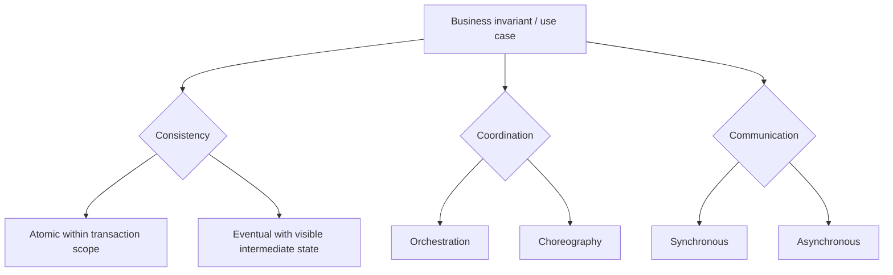

# EC-01 · Consistency, coordination & communication (P1)

## Казус
Поръчка и inventory в една база могат да се update-нат атомарно. Loyalty/email са други системи. Лекция ~03–08 и 38–40 min: dual write и трите оси от Software Architecture: The Hard Parts. Всяка ос е отделен въпрос; sync не означава atomic, async не означава автоматично eventual.

| Вариант | Consistency | Coordination | Communication | Кога / цена |
| --- | --- | --- | --- | --- |
| Local ACID / modular monolith | Atomic за owned rows | Direct service | Local sync | Един owner, immediate invariant; общ deployment |
| XA/2PC | Atomic commit decision за enlisted resources | Transaction coordinator | Prepare/commit | XA-capable resources, blocking/recovery |
| REST Saga | Eventual между participants | Orchestrator | Sync commands | Short bounded workflow; unknown outcome |
| Async Saga | Eventual | Orchestrator | Async commands/replies | Durable long workflow; correlation/retry |
| Choreographed Saga | Eventual | Event reactions | Async | Simple flow; трудно проследими failures |
| Hybrid | Local atomic + eventual integration | Core orchestrator + independent consumers | Both | Explicit critical path; semantic event contract |

Atomic commit не означава global serializable isolation/read visibility. Sync може да върне преди projection; async може да стартира local ACID. Saga coordinator не е XA manager.

**Decision contract:** при cross-system invariant, не при локален CRUD. Печелим ясни trade-offs; цената е ADR и failure analysis, не нова технология. Алтернатива: one DB/one transaction. Доказателство: [System Design](../../../../system-design/04-DATA-COMMUNICATION.md), [ADR](../../../../system-design/06-C4-ADR-REVIEWS.md), [Saga](../../saga/README.md), [failure matrix](08-FAILURE-TESTING.md). Non-runnable note.

Checklist: owners; invariant; scope; timeout/unknown outcome; най-проста алтернатива; recovery test.

## Оригинални източници

[Emanuel Trandafir — Consistency Patterns in Event Driven Architecture](https://www.youtube.com/watch?v=8JuQaWFKk4w) · [Chris Richardson — Saga](https://microservices.io/patterns/data/saga.html) · [PostgreSQL 2PC](https://www.postgresql.org/docs/18/two-phase.html) · [Software Architecture: The Hard Parts](https://www.oreilly.com/library/view/software-architecture-the/9781492086888/) · [Evidence map](SOURCES-AND-EVIDENCE.md)
