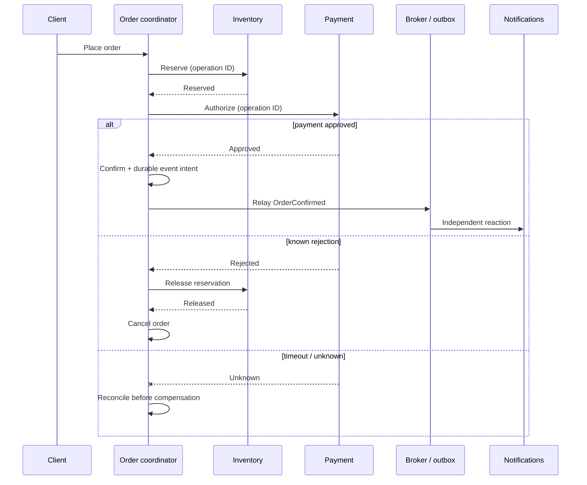

# EC-02 · Hybrid Saga: orchestration + choreography (P1)

## Казус
Order, inventory и payment участват в критичен workflow. Notifications и analytics трябва да могат да се развиват независимо. Лекция 08–18 min: orchestration премества coupling към coordinator; choreography не премахва coupling, а го разпределя между event contracts. Авторът предлага hybrid: външната choreography взаимодейства с orchestrated subsystem през неговата граница. Това е design guideline, не забрана за всички domain events.

Публикувай terminal fact от authoritative boundary. Notification failure не отменя потвърдена поръчка, освен при изрично business изискване. Loyalty може да е critical или optional според продукта. Използвай idempotent commands, correlation/causation IDs, durable workflow state, participant outbox/inbox и reconciliation. Compensation е нова операция, може да се провали; email не може да бъде неизпратен.

[HybridOrderWorkflow](lab/src/main/java/bg/hristomanov/education/consistency/HybridOrderWorkflow.java) + [tests](lab/src/test/java/bg/hristomanov/education/consistency/HybridOrderWorkflowTest.java) демонстрират transitions, unknown outcome, retry и независимост на optional subscribers. In-memory model, не durable Saga; реалните compensation guarantees са в [existing Saga](../../saga/README.md).

**Decision contract:** orchestration за сложен core flow, choreography за независими reactions; не за тривиална локална транзакция. Печелим видим failure flow и независима еволюция; губим coordinator ownership, event versioning, delivery/reconciliation. По-просто: direct module call. Evidence: нов модел + съществуващ Saga lab. Checklist: terminal fact from owner; no hidden cycle; timeout != rejection; compensation idempotency; optional effect independent.

## Оригинални източници

[Emanuel Trandafir — Consistency Patterns in Event Driven Architecture](https://www.youtube.com/watch?v=8JuQaWFKk4w) · [Chris Richardson — Saga](https://microservices.io/patterns/data/saga.html) · [Chris Richardson — Outbox](https://microservices.io/patterns/data/transactional-outbox.html) · [Evidence map](SOURCES-AND-EVIDENCE.md)
