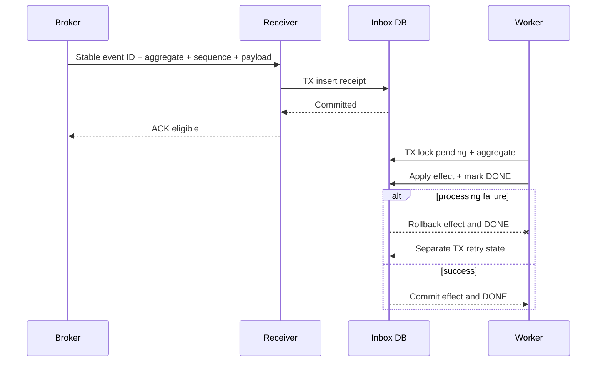
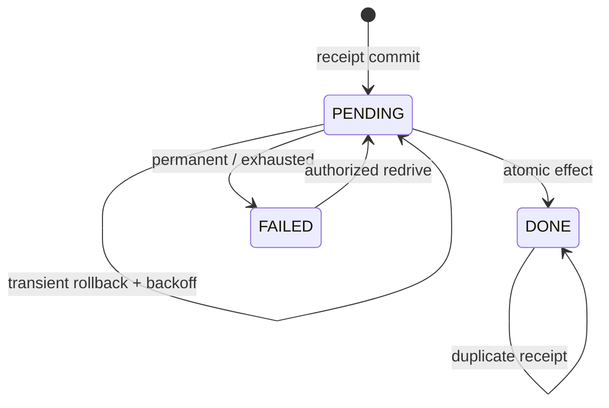

# EC-03 · Durable Inbox & background processing (P1)

## Казус
Consumer получава event, докато business DB е претоварена. Съществуващият [Inbox](../../outbox-inbox/README.md) записва processed ID + effect атомарно. Лекция 34–38 min добавя вариант с трайно съхраняване на целия envelope, ACK след commit, отделен worker. Подходящ при дълга/ограничавана обработка и локално retry управление.

ACK след receipt означава, че broker вече не отговаря за business processing. При Kafka commit на offset само до contiguous durable receipts в partition; не потвърждавай следващ запис при пропуснат предишен. Duplicate след commit преди ACK: сравнявай идентичност и payload. Conflicting duplicate не е успех. При unexpected DB constraint не ACK-вай. Хващай duplicate exception извън rollback-натата транзакция, после проверявай оригиналния envelope. Съхранявай payload, sequence, observedAt, state, attempts, due time и error; retention, encryption, backlog limits и worker fairness са production задачи.

| Подход | Полза / кога | Загуба / кога не |
| --- | --- | --- |
| Processed ID + effect in TX | Кратък handler, простота | Business latency забавя broker |
| Durable payload inbox | Audit/retry/recovery, отделен worker | Допълнителна таблица, eventual delay, backlog |
| Natural idempotency | Прост authoritative upsert | Не стига при delta/conflicting versions/external effect |

[DurableInbox](lab/src/main/java/bg/hristomanov/education/consistency/DurableInbox.java) и [tests](lab/src/test/java/bg/hristomanov/education/consistency/DurableInboxTest.java) използват H2 JDBC transactions и file-backed persistence. Една logical consumer/source, global stable ID и unique aggregate/sequence; single worker. DB commit е реален, broker ACK е caller contract. Production multi-worker: atomic claim/lease или short locks, fencing и per-aggregate ordering; SKIP LOCKED само при подходяща queue semantics. Без бавен remote I/O под DB lock. Не изтривай dedup state преди replay horizon.

Checklist: receipt before ACK; payload identity; effect+status atomic; bounded retry; gap policy; oldest pending; audit/redrive owner.

## Оригинални източници

[Emanuel Trandafir — Consistency Patterns in Event Driven Architecture](https://www.youtube.com/watch?v=8JuQaWFKk4w) · [Chris Richardson — Outbox](https://microservices.io/patterns/data/transactional-outbox.html) · [AWS transactional outbox](https://docs.aws.amazon.com/prescriptive-guidance/latest/cloud-design-patterns/transactional-outbox.html) · [Evidence map](SOURCES-AND-EVIDENCE.md)
