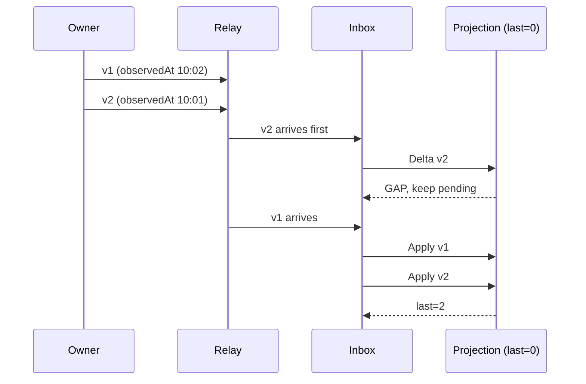

# EC-04 · Ordering, sequence numbers & gap recovery (P1)

## Казус
Outbox relay публикува v2 преди v1, защото v1 retry-ва. Kafka partition order е append order, не непременно causal order на aggregate. Същият key обичайно отива в същия partition при стабилен partitioner/configuration, но retry topics, multiple producers, partition-count changes, concurrency и replay променят assumptions. Лекция 30–38 min предлага сортиране по observedAt в ограничен прозорец. Това е best-effort time ordering, не causal guarantee.

Clock skew, еднакви timestamps и доставка могат да обърнат order. За delta stream присвоявай monotonic sequence per aggregate в source transaction. Consumer заключва/version-CAS state и прилага само next expected sequence. Gap: пази, измервай age, възстанови липсващ event от owner; quarantine или approved rebuild. Old version duplicate не прилага effect; same sequence с друг payload/ID е conflict. Full snapshot може да subsume older version (ако е пълен и tombstone се пази); delta не може да прескочи gap. [Cloud snapshot lab](../../../../system-design/cloud-architecture/06-DATA-OWNERSHIP.md).

[DurableInbox](lab/src/main/java/bg/hristomanov/education/consistency/DurableInbox.java) използва sequence вместо observedAt; [tests](lab/src/test/java/bg/hristomanov/education/consistency/DurableInboxTest.java) обръщат timestamps, доставят v2 първо, проверяват липса на effect, после v1/v2 и правилния баланс. FAILED v1 блокира v2. Retention/rebuild са production extensions.

**Decision contract:** sequence при causal deltas, не при независими commutative операции. Полза correctness; цена gap stalls, storage и recovery. Алтернатива full snapshot или commutative effect + dedup. Checklist: ordering scope; delta/snapshot; gap; conflicts; replay; no global order unless needed.

## Оригинални източници

[Emanuel Trandafir — Consistency Patterns in Event Driven Architecture](https://www.youtube.com/watch?v=8JuQaWFKk4w) · [Spring Kafka non-blocking retry](https://docs.spring.io/spring-kafka/reference/retrytopic.html) · [Retry pattern and ordering](https://docs.spring.io/spring-kafka/reference/retrytopic/how-the-pattern-works.html) · [Evidence map](SOURCES-AND-EVIDENCE.md)
