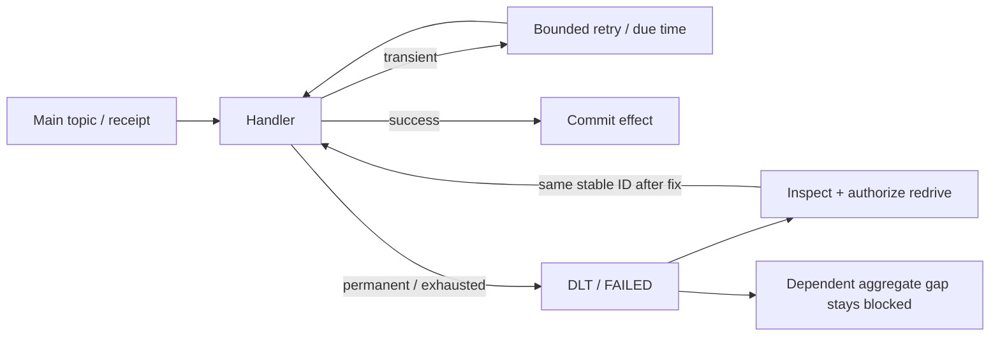

# EC-05 · Retry topics, DLQ & safe redrive (P1)

## Казус
Event v1 временно се проваля; v2 би минал, но е зависим delta. Infinite blocking retry блокира целия partition. Non-blocking retry прехвърля в retry topic и позволява следващи records, но нарушава order. Лекция 36–38 min: retryable/permanent exceptions, retry topics и DLQ. Spring Kafka docs уточняват загубата на ordering guarantees и ограниченията за batch/container transactions.

| Стратегия | Кога / полза | Кога не / цена |
| --- | --- | --- |
| Blocking retry | Малко кратки transient failures; partition order | Дълъг retry блокира и други keys |
| Retry topics | Independent records; main consumer продължава | Extra topics, no original order guarantee |
| Durable Inbox | Local receipt и контролирана обработка | DB storage и operations |
| DLQ/DLT/FAILED | Poison/exhausted; durable diagnostics | Не е успешно business processing; изисква owner |

Класифицирай transient срещу permanent; finite attempts, backoff/jitter, timeout/budget. Lab fixed backoff и explicit time, без sleep. При rollback attempts/failure записваме в отделна TX; crash между тях може да повтори attempt, но локалният effect остава atomic. DLT publish също може да fail-не; не commit-вай offset преди safe handoff. Пази stable ID, оригинални headers, reason, attempt, timestamps с PII/retention ограничения. Redrive след диагностика, разрешение и fix, същото logical ID; не променяй payload под същата идентичност. Corrected event/version или approved rebuild при нужда. Dependent stream не трябва да прескача poison delta.

[DurableInbox](lab/src/main/java/bg/hristomanov/education/consistency/DurableInbox.java) + [tests](lab/src/test/java/bg/hristomanov/education/consistency/DurableInboxTest.java) проверяват terminal failure и explicit redrive. Trusted local operator method, не exposed auth API. Не симулираме реален DLT producer. [Fault tolerance](../../../reliability/fault-tolerance/README.md) за retry policy.

Checklist: classification; due/budget; ordering; DLT handoff; stable ID; owner; oldest pending/failure/retry metrics.

## Оригинални източници

[Emanuel Trandafir — Consistency Patterns in Event Driven Architecture](https://www.youtube.com/watch?v=8JuQaWFKk4w) · [Spring Kafka non-blocking retry](https://docs.spring.io/spring-kafka/reference/retrytopic.html) · [Spring Kafka retry ordering](https://docs.spring.io/spring-kafka/reference/retrytopic/how-the-pattern-works.html) · [Evidence map](SOURCES-AND-EVIDENCE.md)
