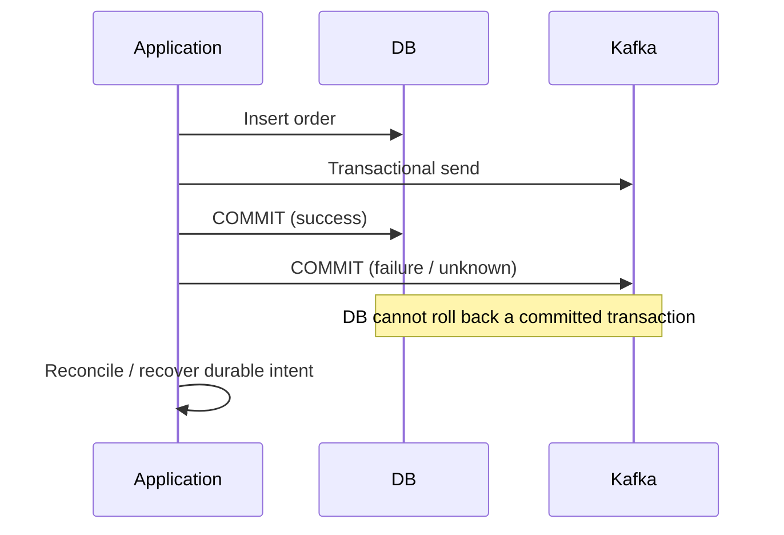
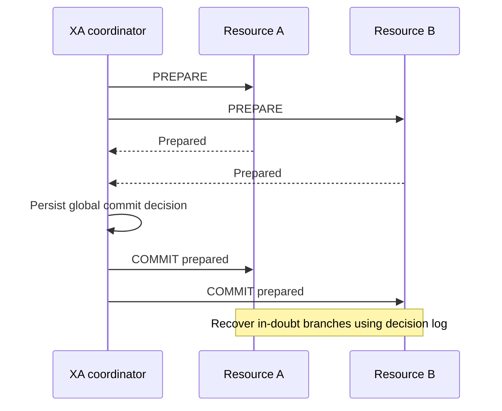

# EC-06 · Kafka transactions vs Outbox vs XA/2PC (P1)

## Казус
Order save и Kafka publish изглеждат успешни, но вторият commit може да се провали. Лекция ~42–45 min Q&A: synchronized commits. Лекторът казва, че не е експериментирал с XA; сравнението му с Saga е неформално. 2PC координира prepare/commit, не business compensation.

Spring Kafka може да синхронизира Kafka TX с DB manager; primary commits first, secondary second. Обратният ред има различен failure window, не го премахва. Secondary exception се връща към caller, но primary вече е commit-нат. Kafka transactions + read_committed + offsets-to-transaction дават scoped Kafka read-process-write EOS; read/process могат да се изпълнят пак; Oracle/payment/email не са в тази атомарна граница. Producer idempotence != application dedup. Unknown commit outcome изисква stable IDs/reconciliation.

Ако prepare fail-не преди commit decision, coordinator rollback-ва prepared branches. След durable commit decision възстановява и довършва commit, не compensates. Partition/coordinator failure може да задържи locks; heuristic outcomes са exceptional hazards. Нужни са XA/JTA manager и XA-capable resources; Kafka producer TX не е general XA participant, HTTP/email не стават автоматично такива. PostgreSQL prepared TX изисква max_prepared_transactions > 0 и външен manager/recovery, inspect pg_prepared_xacts. Oracle XA не е тестван тук.

| Избор | Полза / кога | Цена / кога не |
| --- | --- | --- |
| Kafka EOS | Kafka records + offsets atomic | Не DB+Kafka atomic |
| Synchronized DB+Kafka | По-малко implementation при repairable gap | Вторият commit може да fail-не |
| Outbox | Atomic DB state + publish intent | Relay, duplicates, lag; eventual |
| XA/2PC | Atomic commit decision across enlisted resources | In-doubt locks, recovery, compatibility |
| Saga | Long workflow и business compensation | Visible intermediate states |

[Kafka proof](kafka-lab/README.md) използва embedded local KRaft, real KafkaProducer и H2. DB-first: producer fencing след DB commit, aborted record невидим за read_committed. Kafka-first: commit event, контролирана загуба на H2 connection преди DB commit, SQLException, row absent. Това са deliberately induced commit windows, не Spring synchronization integration или реален XA manager. [Outbox lab](../../outbox-inbox/README.md) доказва atomic intent/relay. XA частта е non-runnable architecture note.

Checklist: enlisted resources; commit order; known vs unknown; durable recovery; offset/isolation; rollback vs compensation; scope of exactly once.

## Оригинални източници

[Emanuel Trandafir — Consistency Patterns in Event Driven Architecture](https://www.youtube.com/watch?v=8JuQaWFKk4w) · [Spring Kafka transactions](https://docs.spring.io/spring-kafka/reference/kafka/transactions.html) · [Spring Kafka EOS](https://docs.spring.io/spring-kafka/reference/kafka/exactly-once.html) · [PostgreSQL 2PC](https://www.postgresql.org/docs/18/two-phase.html) · [PREPARE TRANSACTION](https://www.postgresql.org/docs/18/sql-prepare-transaction.html) · [Evidence map](SOURCES-AND-EVIDENCE.md)
