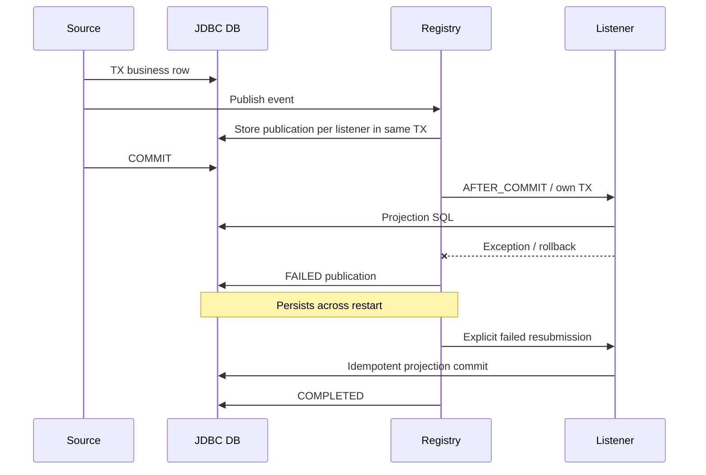

# EC-07 · Spring Modulith Event Publication Registry (P1)

## Казус
Modular monolith публикува local application event за projection. Plain after-commit listener може да се провали след source commit; in-memory event bus не възстановява process death. Лекция 32–34 и 41–42 min споменава Spring Modulith. Надграждаме [съществуващия boundary lesson](../../../architecture/strategic-ddd/05-SPRING-MODULITH.md) с persistent registry.

Spring Modulith 2.1.1 (същата версия като DDD lab) ApplicationModuleListener комбинира after-commit, async и REQUIRES_NEW. Registry съхранява event + listener target в source TX и completion отделно. PUBLISHED, PROCESSING, COMPLETED, FAILED, RESUBMITTED от 2.0. Staleness и FailedEventPublications.resubmit(ResubmissionOptions) за контролирано recovery. ABANDONED е 2.2 addition, не го използваме. Completion update/delete/archive mode влияе на audit/retention. Не включвай безусловно republish on restart в multi-instance deployment. Listener трябва да е idempotent: effect commit и completion recording имат отделен failure window; external effects изискват idempotency/outbox.

[PublicationRegistryTest](lab/src/test/java/bg/hristomanov/education/consistency/PublicationRegistryTest.java): Boot 4.1.1/Modulith 2.1.1 JDBC registry, file-backed H2; rollback source → no publication/effect; listener throws after SQL → listener TX rollback, FAILED; close/reopen context, explicit resubmit, projection and COMPLETED. Bounded await, actual async listener. Не доказва hard kill, multi-instance claim или production Oracle migration. Един table може да пази различни listener targets; избор на таблици според ownership/retention/queries, не непременно една на topic.

**Decision contract:** durable local events за независими after-commit effects в един deployable; не за immediate invariant (direct call), не automatic remote EOS. Полза recovery/decoupling; цена storage, async delay, schema/serialization, replay. Алтернатива direct API или DB outbox за remote event. Checklist: source/listener TX; persisted target; retry; idempotency; retention; stale metrics.

## Оригинални източници

[Emanuel Trandafir — Consistency Patterns in Event Driven Architecture](https://www.youtube.com/watch?v=8JuQaWFKk4w) · [Spring Modulith 2.1 events](https://docs.spring.io/spring-modulith/reference/2.1/events.html) · [2.1.1 registry API](https://docs.spring.io/spring-modulith/docs/2.1.x/api/org/springframework/modulith/events/core/EventPublicationRegistry.html) · [2.1.1 listener API](https://docs.spring.io/spring-modulith/docs/2.1.x/api/org/springframework/modulith/events/ApplicationModuleListener.html) · [Evidence map](SOURCES-AND-EVIDENCE.md)
