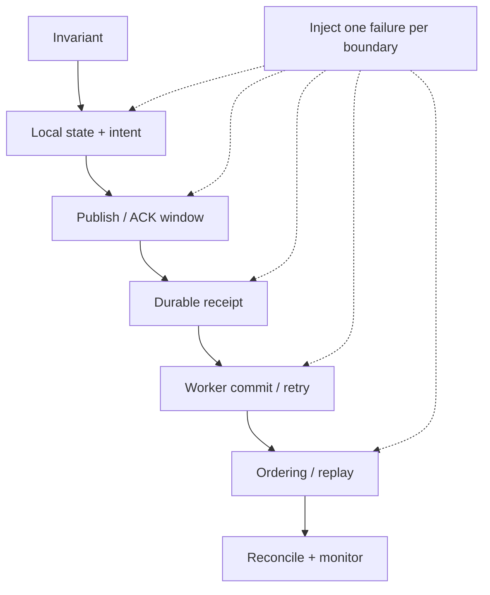

# EC-08 · End-to-end consistency and failure testing (P1)

## Казус
Зелен unit test проверява всички mock calls, но не проверява commit failure, duplicate или business state. Лекция 03–06 min: много mocks са design signal; 20–24 min demo: бавно external I/O задържа connections и забавя независими reads. Не повтаряме лекционните latency числа като наши измервания.

| Failure injection | Независим expected outcome | Evidence |
| --- | --- | --- |
| DB fail след external publish | Kafka event остава, DB row absent | [Kafka lab](kafka-lab/README.md) |
| DB commit, Kafka fenced | DB row present, aborted record invisible read_committed | same |
| Slow remote I/O holds DB lease | Unrelated read waits for pool | [JPA performance](../../../../persistence/jpa-performance/README.md), [VM-26](../../../../database/transaction-labs/VM-26-POOL-BACKPRESSURE.md) |
| Receipt fails before commit | No durable receipt/ACK eligibility | [Inbox tests](lab/src/test/java/bg/hristomanov/education/consistency/DurableInboxTest.java) |
| Receipt commit, ACK lost | Duplicate receipt, one effect | same |
| Effect SQL then failure | Effect and DONE rollback, retry tracked | same |
| v2 before v1 | No gap application, eventual correct delta | same |
| Poison/exhausted retry | FAILED; dependent version blocked | same |
| Payment unknown | Reconcile; optional subscriber independent | [hybrid tests](lab/src/test/java/bg/hristomanov/education/consistency/HybridOrderWorkflowTest.java), [Saga](../../saga/README.md) |
| Modulith listener fails + restart | Source remains; persistent recovery | [registry test](lab/src/test/java/bg/hristomanov/education/consistency/PublicationRegistryTest.java) |

Operational signals: oldest outbox/inbox, gap age, retry/DLT, duplicates/conflicts, reconciliation difference, Saga age/compensation, Hikari active/idle/pending, remote timeout, broker lag vs business completion lag. Correlation event ID, aggregate/version, saga ID; без raw sensitive payload logs. SLO per journey, authorized replay/runbook.

**Capstone:** map original order flow; choose local ACID/Outbox and hybrid Saga if justified; draw ACK vs processing, ordering, failure/replay; compare simpler monolith. Non-runnable architecture note. Decision contract: failure tests according to risk; не заменяй всички unit tests с тежки broker tests. Полза correctness evidence, цена CI/runtime. Checklist: before/after commit, ACK loss, duplicate, gap, restart, exhaustion, scope.

## Оригинални източници

[Emanuel Trandafir — Consistency Patterns in Event Driven Architecture](https://www.youtube.com/watch?v=8JuQaWFKk4w) · [Spring Kafka transactions](https://docs.spring.io/spring-kafka/reference/kafka/transactions.html) · [Spring Modulith 2.1 events](https://docs.spring.io/spring-modulith/reference/2.1/events.html) · [Chris Richardson — Saga](https://microservices.io/patterns/data/saga.html) · [Chris Richardson — Outbox](https://microservices.io/patterns/data/transactional-outbox.html) · [Evidence map](SOURCES-AND-EVIDENCE.md)
