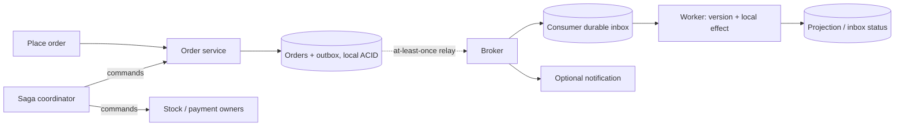

# Event-Driven Consistency — advanced engineering (P1)

> Продължение на [Integration Patterns](../README.md) по [Emanuel Trandafir — Consistency Patterns in Event Driven Architecture](https://www.youtube.com/watch?v=8JuQaWFKk4w). Прегледан предоставеният auto-generated English SRT (~45 min). Преизползваме [Outbox/Inbox](../../outbox-inbox/README.md), [Saga](../../saga/README.md), [Idempotency](../../../reliability/idempotency/README.md) и [transaction/pool labs](../../../../database/transaction-labs/VM-26-POOL-BACKPRESSURE.md).

## Входен казус

E-commerce service създава поръчка, намалява stock в локална база, публикува Kafka event, записва файл, извиква loyalty API и изпраща email. Последната операция се проваля. Локалният rollback не връща вече настъпилите външни ефекти. Mock interaction tests могат да пропуснат архитектурния проблем; броят mock-ове е сигнал за проверка, не доказателство за лош дизайн.

Схемата е наша адаптация: transport не е global transaction; бизнес coordination е отделна от delivery. Optional consumers не променят lifecycle на Saga зад гърба на coordinator.

## Учебна карта

| ID | Глава | Доказателство |
| --- | --- | --- |
| EC-01 | [Three-axis decision matrix](01-DECISION-MATRIX.md) | ADR + existing labs |
| EC-02 | [Hybrid Saga](02-HYBRID-SAGA.md) | Workflow model + existing durable Saga |
| EC-03 | [Durable Inbox](03-DURABLE-INBOX.md) | H2 JDBC, receipt, retry |
| EC-04 | [Ordering & gaps](04-ORDERING-GAPS.md) | Sequence, gap, timestamp counterexample |
| EC-05 | [Retry, DLQ & redrive](05-RETRY-DLQ.md) | Backoff, terminal failure, explicit redrive |
| EC-06 | [Kafka transactions vs Outbox vs XA/2PC](06-KAFKA-XA-2PC.md) | Real local Kafka + H2, opt-in |
| EC-07 | [Spring Modulith Event Publication Registry](07-MODULITH-REGISTRY.md) | JDBC persisted failure, restart, resubmit |
| EC-08 | [End-to-end failure testing](08-FAILURE-TESTING.md) | Matrix and capstone |

## README → code → test

- [DurableInbox](lab/src/main/java/bg/hristomanov/education/consistency/DurableInbox.java) · [H2 tests](lab/src/test/java/bg/hristomanov/education/consistency/DurableInboxTest.java).
- [HybridOrderWorkflow](lab/src/main/java/bg/hristomanov/education/consistency/HybridOrderWorkflow.java) · [workflow tests](lab/src/test/java/bg/hristomanov/education/consistency/HybridOrderWorkflowTest.java).
- [Modulith registry integration](lab/src/test/java/bg/hristomanov/education/consistency/PublicationRegistryTest.java) — actual 2.1.1.
- [Kafka commit windows](kafka-lab/src/test/java/bg/hristomanov/education/consistency/kafka/KafkaCommitWindowTest.java) — actual local broker.
- [Default lab](lab/README.md) · [broker lab](kafka-lab/README.md) · [Exercises](EXERCISES.md) · [NotebookLM](NOTEBOOKLM-PROMPT.md).

Не са нужни cloud account, production broker или credentials. Default lab използва H2 и persistent Modulith registry; Kafka е opt-in/targeted CI. EC-01 и EC-08 са архитектурни бележки с повторно използване на съществуващите тестове. XA частта на EC-06 е design note, не реален XA manager.

## Изход

Можеш да избираш local ACID, Saga или 2PC според invariant; да различаваш broker ACK от business completion; да проверяваш durable receipt, retries, gaps, commit order, restart recovery и scope на EOS. Не разбивай локален service на microservices, само за да приложиш patterns.

## Оригинални източници

[Emanuel Trandafir — Consistency Patterns in Event Driven Architecture](https://www.youtube.com/watch?v=8JuQaWFKk4w) · [Chris Richardson — Saga](https://microservices.io/patterns/data/saga.html) · [Chris Richardson — Outbox](https://microservices.io/patterns/data/transactional-outbox.html) · [Spring Kafka transactions](https://docs.spring.io/spring-kafka/reference/kafka/transactions.html) · [Spring Modulith 2.1 events](https://docs.spring.io/spring-modulith/reference/2.1/events.html) · [Evidence map](SOURCES-AND-EVIDENCE.md)
