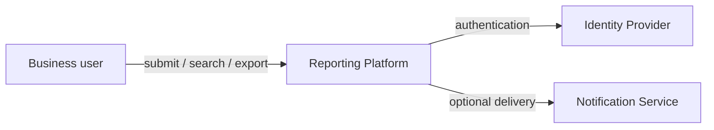
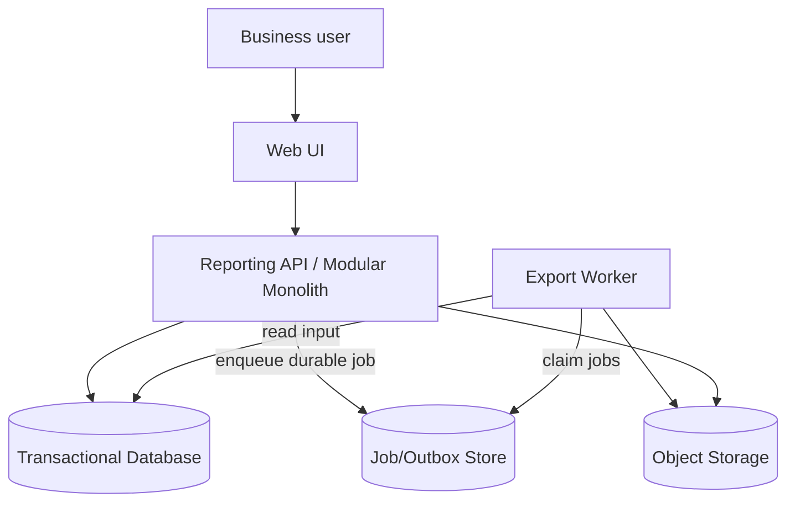

# SD-14/15 — C4, Architecture Decision Records (ADR) and fitness functions

> **P1 · документационен workshop**, не отделен runnable module. Основни източници: [Simon Brown — C4 Model](https://c4model.com/), [UK Government Digital Service — Documenting architecture decisions](https://gds-way.digital.cabinet-office.gov.uk/standards/architecture-decisions.html), [AWS Well-Architected](https://docs.aws.amazon.com/wellarchitected/latest/framework/).

## 1. Проблемът: диаграма ≠ обосновано решение

Нови инженери виждат 35 boxes, но не знаят кой държи бизнес транзакцията, кой е owner на данните и при какъв failure request-ът става неуспешен. Няма контекст защо е избрана queue, в какъв момент ще преразгледаме решението или кои инварианти трябва да пазим.

Правим **три комплементарни артефакта**:
- C4 — общ език за boundaries, people, systems и deployable containers;
- ADR — контекст, алтернативи, решение, цена и revisit;
- архитектурни fitness functions — проверки в code/CI и metrics, които показват дали границите оцеляват.

## 2. C4 levels (правилни термини)

| Level | Какво показва | Какво НЕ е |
| --- | --- | --- |
| L1 System Context | actors, нашия software system, външни systems и relations | full deployment topology |
| L2 Containers | deployable/runnable units: web app, API, DB, workers, broker | Docker containers задължително |
| L3 Components | meaningful substructures в container | всяка Java class или every private method |
| L4 Code (optional) | classes/packages/code structure, когато има смисъл | задължителна UML за всяка система |

Допълнително C4 има dynamic и deployment diagrams. **Не започвай с L4**, ако stakeholder-ите още не знаят от каква система зависи business journey.

### Пример C4 L1, schematic



### Пример L2, нарочно без „всичко е микросървис“



**Уточнение:** тази диаграма е **candidate architecture**, не въведена production схема и не е измерено reliability доказателство. Използвай [case study](07-REPORTING-PLATFORM-CASE.md) за уточненията.

## 3. ADR template — попълвай конкретно, не лозунги

```markdown
# ADR-NNN — Decision title
Status: Proposed | Accepted | Superseded
Date: YYYY-MM-DD
Owner / reviewers: ...
Context:
- business journey + quality attribute / constraints
- evidence: measurements, incidents, unknowns

Options:
A. most-simple viable alternative
B. chosen alternative
C. other serious alternative
Decision:
- choose B, given [explicit assumptions]
Consequences:
- benefits and losses, team/ops cost, security/data implications
Verification:
- load/failure/integration test, observable metric and thresholds
Revisit when:
- measurable traffic, boundary or team condition changes
References:
- primary sources and existing runnable modules
```

**GDS practice:** accepted decision не се редактира ретроактивно сякаш историята не е съществувала; при съществена промяна добави нов ADR, отбележи стария като superseded и линкни.

Примерен попълнен ADR: [ADR-0001 — Modular monolith for transactional core](decisions/0001-modular-monolith-for-core.md).

## 4. Fitness functions: гаранции, които можем да проверяваме

- **Code boundary:** no imports от `reporting.application` към `reporting.persistence` concrete classes; използвай ArchUnit (виж [Strategic DDD](../spring/architecture/strategic-ddd/README.md)).
- **Data consistency:** negative integration test, че failed commit не оставя outbox event; replays не създават duplicate business effect (виж [Outbox/Inbox](../spring/messaging/outbox-inbox/README.md)).
- **Performance:** representative load test, p99, DB wait, success rate и saturation **не** просто `mvn test`.
- **Security:** HTTP negative test с чужд tenant/document ID и независима проверка на owning-service permissions (виж [Threat Modeling](../spring/security/threat-modeling/README.md)).
- **Operational:** canary, rollback, DR drill, metrics; нито един кодов unit test не доказва действително RTO/RPO.

## 5. Кога този подход е излишен?

За малък скрипт с един maintainer може да стигне прост `README` и една схема. Не прави 15 диаграми и 20 ADRs без реални необратими решения. **Полза:** traceable choices, shared language. **Цена:** documentation upkeep, review. **Alternative:** една concise decision note; ADR при decisions, които са важни или скъпи за промяна.

## 6. Упражнение

Подготви 1 C4 L1 и 1 L2 за платформа от [case study](07-REPORTING-PLATFORM-CASE.md). Избери между:
- synchronous export,
- durable background worker с job store,
- нов export microservice + broker.

За всяка опция посочи ownership, error/failure semantics, freshness, security, cost, тест и **условие за revisit**. Документът може да не използва AWS/Azure — концепциите са provider-agnostic.
