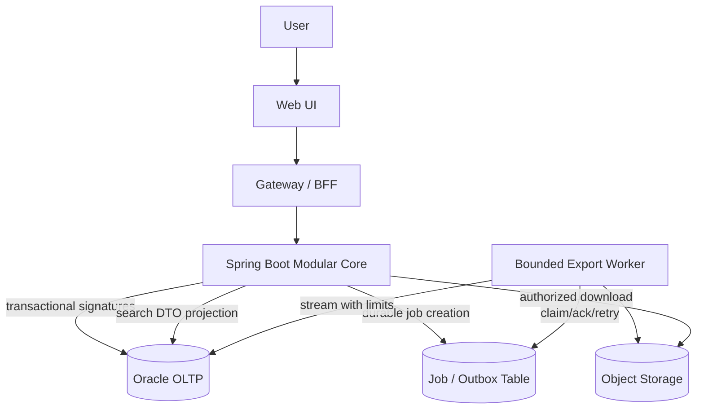

# SD-16 — End-to-end worked case: reporting and document signing platform

> **P1 Senior design exercise / proposed solution, not production architecture.** Числата и ограниченията са **учебни допускания**, не сведения за реален проект. Приложи [Google SRE NALSD design method](https://sre.google/workbook/non-abstract-design/): possible → better → feasible → resilient; repeat.

## 1. Business problem & requirements

Платформа обслужва:
- подписване на административен документ (correctness, legal authority, auditable state change);
- търсене по филтри (responsiveness, read efficiency, security);
- експортиране на големи справки (bounded resource use, delayed download acceptable).

**Constraints:** Oracle OLTP, Java 25 / Spring Boot, one team, no mandatory Kafka, strict access controls, unknown budget. Не твърдим автоматично GDPR compliance или real signature validity — това изисква domain/security review.

### Candidate SLOs (за обсъждане, не договорени)

| Journey | Proposed SLO | Key risk |
| --- | --- | --- |
| Submit signature | >= 99.9% correct outcomes за eligible attempts/rolling 28d | duplicate POST, lost commit, unauthorized transition |
| Search | >= 99% successful eligible queries <= 500ms/rolling 28d | stale filter semantics, DB locks, heavy scans |
| Export enqueue | >= 99.9% eligible jobs correctly persisted/rolling 28d | accepted job without durable write |
| Export completion | >= 99% completed within 5 minutes in eligible workload class | backlog age, oversized reports, retries |

**Внимание:** availability ≠ completion latency; `202 Accepted` не е completed export.

## 2. Workload calculation — hypothetical

За споделена API traffic class: 8.64M req/day, 5× peak, 200 ms mean latency, 20% writes, 2 KiB response, **hypothetically measured** 150 sustained RPS/replica at tested p99/error profile, 60% planned usage. Получаваме 100 avg RPS, 500 peak RPS, ~100 mean in-flight, 100 primary DB writes/s, ~0.977 MiB/s raw response payload, **6 instances initial estimate**.

Това НЕ доказва service p99, DB capacity, end-to-end throughput или цена. [CapacityPlanner test](capacity-lab/src/test/java/bg/hristomanov/education/systemdesign/CapacityPlannerTest.java) доказва само аритметиката и validation boundaries. За real sizing трябват load tests и actual Hikari/Oracle wait/CPU/IO metrics.

## 3. Architecture iteration A — simplest viable monolith

```text
Browser → Spring MVC app
               ├─ Documents/Signing module ───→ Oracle OLTP (ACID)
               ├─ Search/read DTO queries ────→ Oracle OLTP
               └─ Synchronous export ─────────→ large result stream
```

**Добро за:** малък export, simple CRUD, малък team. **Проблем при ръст:** export-ите държат connections/threads и могат да навредят на interactive requests. Първото решение може да е `fetchSize`, streaming с bounded memory и client limits (виж [JDBC streaming](../database/transaction-labs/VM-18-JDBC-FETCH-SIZE-STREAMING.md)), **не** задължително брокер.

## 4. Architecture iteration B — modular core + bounded background exports



**Not a mandatory topology:** `job` може да е таблица в същата Oracle база; storage е proposed option. За async correctness **job state must be durable**; in-memory queue alone cannot guarantee recovery. При голяма система worker може да стане самостоятелен deployable, но това не прави автоматично `documents` отделен microservice.

### Positive business flow

1. Verify actor's permission **inside owning service**, not only gateway.
2. Sign command uses idempotency mechanism for duplicate submissions, expected version check and local DB commit.
3. Search sees authoritative state when required; analytics projection may have documented freshness delay.
4. Export request validates scope, creates durable `QUEUED` job and returns job ID `202` — job is NOT ready yet.
5. Worker claims with bounded concurrency and max rows/time, writes output, updates `COMPLETED` with metadata; client downloads only after authorization check.

### Negative flows

| Failure | Expected contract / mitigation |
| --- | --- |
| Client retries sign after timeout | same idempotency key does not duplicate transition; conflicting payload is rejected |
| DB transaction rollback | no partial signature committed, no false publish |
| Worker crashes after output write | restart detects checkpoint/job lease; safe retry without duplicate visible result |
| DB pool saturated | bounded admission/backpressure, not unbounded retries |
| Stale search projection | display projection lag or force authoritative lookup for safety-critical decision |
| Authz bypass attempt / foreign document | 403/404 policy according to privacy contract; no leak/side effect |
| Queue backlog grows | age metrics, admission/rejection, worker scaling only if bottleneck measured |
| One app node fails | routing/probes and instance redundancy; **not** automatic DB failover |
| Region outage | RPO/RTO depend on backup/replica/failover procedure, must be tested |

## 5. Critical alternatives and decisions

| Decision | Chosen candidate | Simple alternative | When to revisit |
| --- | --- | --- | --- |
| Service style | Modular monolith for core | Layered monolith | independent releases/ownership, measured growth |
| Search | Oracle indexed DTO queries, optionally projection | JPA entity fetch for light reads | real query plan, p99/DB load justify |
| Async export | DB durable job store + bounded worker | synchronous streaming | export size/latency and backlog evidence |
| Consistency | local ACID for signature; eventual allowed for export status/projection | all reads from primary when freshness essential | business freshness requirements |
| Scale | first tune DB/connection lifecycle then replicas | one well-sized instance | actual load-test saturation |
| Cache | optional for stable public/reference reads | no cache | measured cacheable read pressure and safe invalidation |

**ADR:** [documented proposed decision](decisions/0001-modular-monolith-for-core.md).

## 6. Production validation plan — not merely unit tests

- Characterization and negative tests: unauthorized sign, duplicate POST, stale version, invalid parameters.
- Real PostgreSQL/Oracle environment when claiming database lock/cursor semantics; H2-only tests are not enough to validate Oracle behavior.
- Load test: vary concurrent clients, offered RPS, response sizes; sample end-to-end latency **p50/p95/p99** and business goodput/error/DB wait metrics.
- Chaos/failure injection: kill worker after write, retry duplicate, DB failure, temporary downstream outage; assess queue lag and recovery.
- Operational: rollback/drain, backup restore drill, audit retention, secrets/PII safety, actual observed RTO/RPO.

## 7. Senior-level independent challenge — DO NOT SHOW SOLUTION FIRST

A new requirement says: „От 500 peak RPS към 5 000 RPS, export within 30 seconds, strict freshness after sign, two regions active/active, budget only +15%.“

За **60–90 минути whiteboard и кратък ADR**:
1. Reformulate requirements and identify contradictions/unknowns.
2. Draw C4 L1/L2, signing critical path and async export sequence.
3. Make capacity sizing assumptions and show math.
4. Compare 3 architectures (monolith+worker, modular monolith+independent workers, split microservices).
5. State data ownership, consistency, idempotency, failure domains, RTO/RPO.
6. Design at least 5 test cases (negative/performance/failure).
7. List 3 explicit *revisit triggers* and defend operational cost.

**Никаква предварителна „идеална архитектура“:** решението трябва да се адаптира към измервания и constraints.
