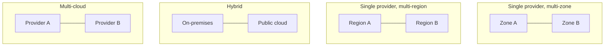

# CA-01 · Cloud deployment strategies (P1)

## Казус

Fleet platform има 99.9% цел за основни операции и отчети, които могат да изостават 15 min. Архитект предлага „AWS + GCP за reliability“, но бизнесът не е установил дали иска независимост от provider, best-of-breed analytics, data residency или recovery. Без това изборът не може да се оцени.

**Лекция 02:08–06:55:** Touret използва по-тясно определение — един интегриран продукт, разпределен между доставчици, а не две несвързани потребителски системи. В практиката multi-cloud може да означава и portfolio от независими workloads. Hybrid и multi-cloud са различни оси, могат да съществуват едновременно.

Това са варианти за deployment, не последователни стъпки. Zone/region/provider не са взаимозаменяеми failure domains; споделени DNS, IdP, CI, credentials, backbone, vendor dependencies могат да създадат common-mode failure.

| Вариант | Кога / какво решава | Кога НЕ / загуби | Доказателство и алтернатива |
| --- | --- | --- | --- |
| Single-zone | Dev или некритичен workload с restore tolerance | Не за production SLO, зависим от zone failure | Restore drill; multi-zone ако рискът го налага |
| Single-cloud multi-zone | Zone outage; сравнително малък ops overhead | Не покрива region/provider-wide failure | Zone loss test и dependency map |
| Single-cloud multi-region | Region loss, latency/residency | Не ако single-region DR покрива целта; replication, routing и consistency цена | Region failover + failback, RPO/RTO |
| Hybrid | Legacy/on-prem/data constraints | Не само защото има datacenter; network/ops complexity | Dependency/network drill; migrate capability ако може |
| Partitioned multi-cloud | Best-of-breed, contract/compliance, acquired systems | Не за redundancy по подразбиране; два IAM/IaC/skillsets и egress | Failure graph per journey, exit drill; single cloud с facade |
| Redundant multi-cloud | Независим recovery при provider outage, доказано business need | Не при shared control plane/DB или липса на operations; multi-writer complexity | Provider loss game day и data recovery; първо multi-region |

## Работен избор

За учебния казус избираме partitioned multi-cloud за tracking/analytics и customer/payments, но **не** обещаваме, че tracking ще преживее GCP outage. Ако целта е provider-loss recovery, трябва втори готов deployment и независими recovery dependencies ([CA-04](04-DISASTER-RECOVERY.md)). Ако целта е само 99.9% customer journey, първо сравняваме single-cloud multi-zone с optional analytics. Не използваме две cloud услуги заради маркетинг.

**Упражнение (architecture note):** попълни ADR за 3 алтернативи, зададени availability, residency, RPO/RTO, skills, annual TCO, exit cost. Остави unknown като unknown. Измери dependency failure и избери най-простото решение. Checklist: business rationale; topology ≠ guarantee; независимост на данни/ключове/CI; owner; recovery test.

## Оригинални източници

[Touret — Devoxx Poland 2026](https://www.youtube.com/watch?v=mOmuF5fDiUM) · [Touret — Part 1](https://blog.touret.info/2026/03/12/multi-cloud-from-the-trenches-part1/) · [Google Cloud — hybrid/multicloud patterns](https://docs.cloud.google.com/architecture/hybrid-multicloud-patterns-and-practices) · [AWS — recovery strategies](https://docs.aws.amazon.com/wellarchitected/latest/framework/rel13-bp02.html) · [Карта на evidence и ограниченията](SOURCES-AND-EVIDENCE.md)
