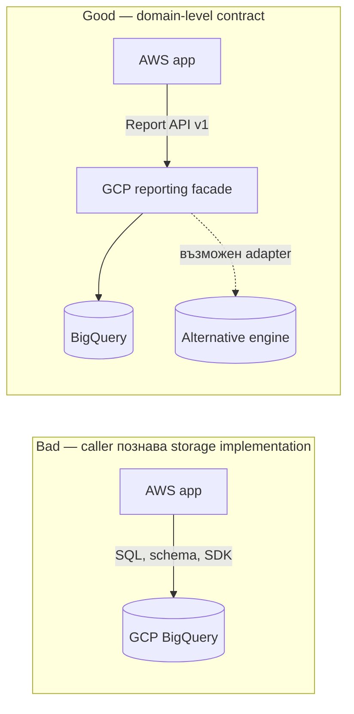

# CA-02 · Cloud boundaries, coupling & vendor lock-in (P1)

## Казус

AWS customer service има BigQuery SDK, SQL и credentials. При schema/SQL change е нужен AWS release от друг екип. Наивното решение „всичко на Kubernetes“ решава packaging, не договорите и data migration.

Лекция 04:00–05:55, 07:00–13:25, 27:35–29:55: best-of-breed може да е по-изгодно от lowest common denominator; разполагането на bounded context в един provider е полезна евристика, не DDD правило. Авторът предлага facade API пред BigQuery.

Facade връща domain report DTO, не универсален SQL proxy. Versioning, ownership, pagination, time budget, errors и auth са част от договора. Facade не скрива latency, semantics или всички breaking changes. Избягвай giant generic cloud abstraction; ports на естествени бизнес граници, adapters за действително различни реализации.

## Portability inventory / exit strategy

| Asset | Преносимо | Скрит lock-in / rehearsal |
| --- | --- | --- |
| Java OCI image | Runtime и image | CPU architecture, secrets, registry, egress; build/run другаде |
| Kubernetes manifests | Основни ресурси | LoadBalancer annotations, CSI storage, CNI, IAM, operator API; deploy на втори cluster |
| PostgreSQL | SQL и logical export | extensions, collations, managed replication, backups, identity; restore + query tests |
| BigQuery/warehouse | Data export | dialect, partition cost, scheduled queries, ML, permissions; migrate sample data и parity |
| IAM | OIDC/OAuth protocols | federation, role semantics, key lifecycle, workload identities; replay policy tests |
| Messaging | Domain event contract | delivery/ordering semantics, quotas, retention; replay и duplicate tests |

## Decision contracts

- Facade: решава consumer/storage coupling; използвай при независимо развиващи се contexts, не за един локален call с един owner. Печелим change isolation; губим hop, API/versioning и support. Алтернатива: shared module или direct SDK вътре в owner. Доказателство: contract tests и [HTTP analytics client](lab/src/main/java/bg/hristomanov/education/cloud/AnalyticsClient.java).
- Managed service: печелим специализирани функции, operational leverage; губим exit effort, data egress, provider constraints. Използвай при business gain над switching risk; не при задължителна portability, която не можем да докажем. Алтернатива: стандартен managed PostgreSQL/self-host само с наличен ops capacity.
- Kubernetes: печелим повторяем app deploy; губим cluster upkeep и provider integration. Не използвай като portability promise без rehearsal. Виж [Kubernetes lab](../../infrastructure/kubernetes/README.md).

**Упражнение (architecture note):** inventory с owner, data size, alternative, code rewrite, export duration, outage budget, migration cost, contract constraints и trigger. Изпълни sample export/import, test parity, verify rollback/retention. Не записвай измислени оценки като измервания. Checklist: bounded context ≠ provider; no shared DB across owners; versioned semantic contract; rehearsed exit.

## Оригинални източници

[Touret — Devoxx Poland 2026](https://www.youtube.com/watch?v=mOmuF5fDiUM) · [Touret — Part 1](https://blog.touret.info/2026/03/12/multi-cloud-from-the-trenches-part1/) · [Touret — Part 2](https://blog.touret.info/2026/04/16/multi-cloud-from-the-trenches-part2/) · [Kubernetes cloud controller](https://kubernetes.io/docs/concepts/architecture/cloud-controller/) · [Google Cloud — hybrid/multicloud patterns](https://docs.cloud.google.com/architecture/hybrid-multicloud-patterns-and-practices) · [Карта на evidence и ограниченията](SOURCES-AND-EVIDENCE.md)
