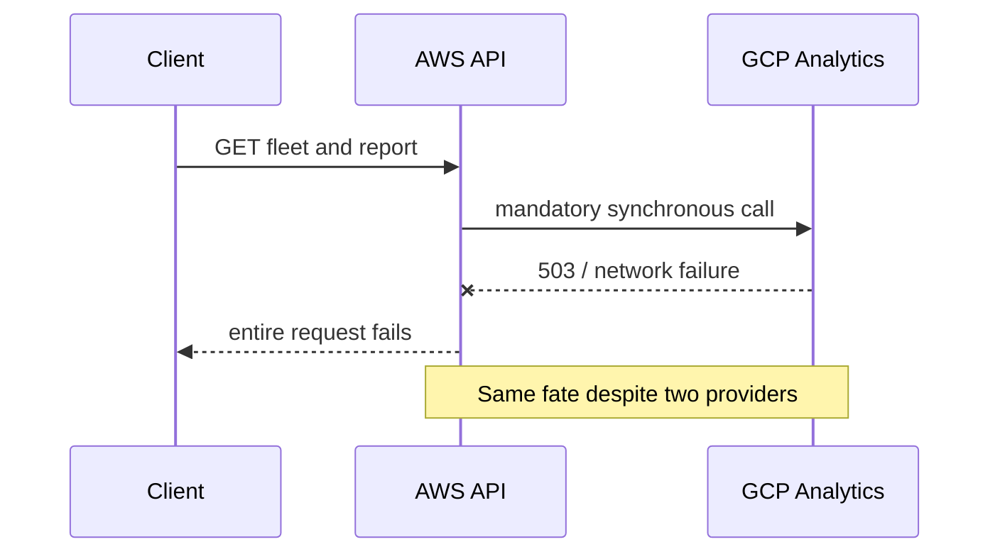
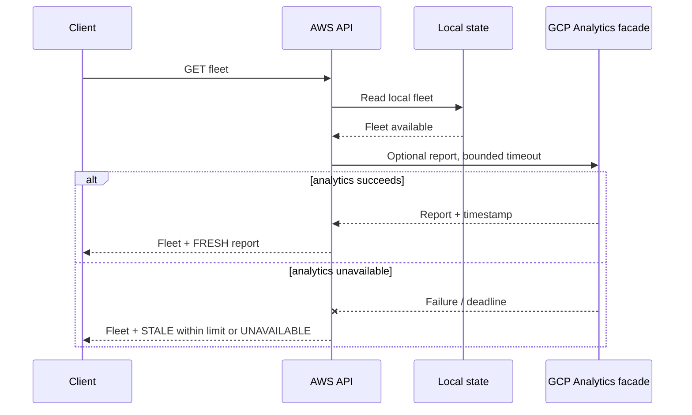

# CA-03 · Cross-cloud communication & reliability (P1)

## Казус

Потребителят зарежда автомобилите си; отчетът е optional. AWS API чака синхронно GCP. Ако remote analytics върне 503 или network timeout, целият екран се проваля. Retry без deadline увеличава queue, resource usage и load. Раздели business criticality, не само services.

Optional synchronous call още добавя latency. Ако core SLO не може да го понесе, отдели report endpoint или async local projection. Не fallback към стари данни за плащане, permission или safety-critical decision. Не показвай stale като fresh. Тестовете използват synthetic read-only report с bounded cache; не production cache policy.

## Composite availability — корекция на лекцията 13:30–15:20

За две задължителни услуги общата наличност е P(A∩B). При independent failures, сравними time windows и binary success: A=0.99, B=0.95 → 0.9405 = 94.05%. Без independence знаем bounds: max(0,A+B−1)=94%; min(A,B)=95%. Минимумът е горна граница, не формула. С shared IdP, network, DNS, gateway добавяме зависимости; SLA на доставчик ≠ наблюдавана SLI. Ако две независимо достатъчни реплики имат ideal instantaneous routing и няма shared failure, P(any)=1−(1−A)(1−B); това не е обещание за real failover. [CloudBudget](lab/src/main/java/bg/hristomanov/education/cloud/CloudBudget.java) и [tests](lab/src/test/java/bg/hristomanov/education/cloud/CloudBudgetTest.java).

## Decision matrix

| Техника | Решава / кога | Кога НЕ / цена | Доказателство |
| --- | --- | --- | --- |
| Synchronous facade | Immediate authoritative result, low call count | Не ако optional или long-running; network fate, latency | Deadline, status/error/contract tests |
| Bounded retry + backoff/jitter | Transient failure, idempotent operations, remaining budget | Не за non-idempotent side effect, 4xx auth или saturated system; extra load | [Existing fault tolerance](../../spring/reliability/fault-tolerance/README.md) |
| Optional fallback | Read-only stale data с изричен freshness contract | Не за auth/payment; staleness и client complexity | [FleetDashboard](lab/src/main/java/bg/hristomanov/education/cloud/FleetDashboard.java) + [tests](lab/src/test/java/bg/hristomanov/education/cloud/CrossCloudFailureTest.java) |
| Async projection | Remove remote critical-path dependency; eventual freshness allowed | Не за atomic cross-domain consistency; lag, replay, ops | [CA-06](06-DATA-OWNERSHIP.md) |

По-проста алтернатива: един provider и отделен reporting endpoint. Измери p95/p99 по journey, remote call count, timeout rate, stale/unavailable rate, error budget; не сумирай percentiles като точна end-to-end стойност. Capacity и bulkhead остават отделни от circuit breaker. Lab използва actual loopback HTTP, не реален cross-cloud network.

Checklist: критични зависимости; timeout ≤ remaining deadline; retry budget; idempotency; stale label/age; separate SLI; test outage + recovery.

## Оригинални източници

[Touret — Devoxx Poland 2026](https://www.youtube.com/watch?v=mOmuF5fDiUM) · [Touret — Part 2](https://blog.touret.info/2026/04/16/multi-cloud-from-the-trenches-part2/) · [Google Cloud — distributed patterns](https://docs.cloud.google.com/architecture/hybrid-multicloud-patterns-and-practices/distributed-patterns?hl=en) · [Google Cloud — hybrid/multicloud patterns](https://docs.cloud.google.com/architecture/hybrid-multicloud-patterns-and-practices) · [Карта на evidence и ограниченията](SOURCES-AND-EVIDENCE.md)
