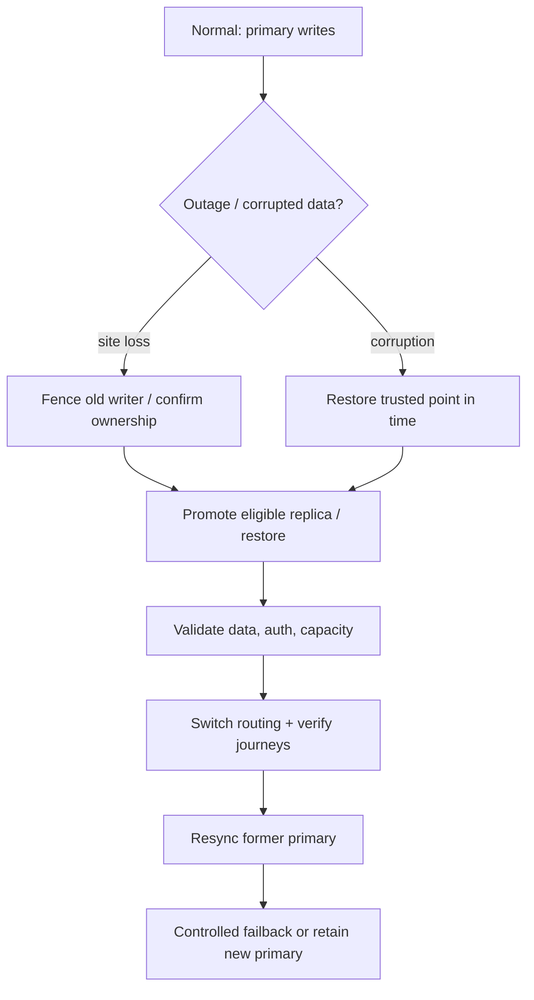

# CA-04 · Disaster recovery & failover (P1)

## Казус

Tracking primary изчезва заради region outage, а платежният домейн трябва да продължи. Две cloud места не означават, че едното има usable копие на другото. **Тази глава е наше допълнение** към reliability/NFR от лекцията, на база AWS Well-Architected.

- Availability: поддържаме service при component failure; DR: възстановяваме workload след disaster. RTO = максимално допустима продължителност на възстановяване; RPO = максимално допустима загуба на данни като време. SLO не замества RTO/RPO.
- Задай RTO/RPO за business capability, а не един global number. Backup ≠ replica: replication копира corruption/deletion; пази versioned/PITR backup, immutable copies и проверен restore.
- Целите са договорени, actual recovery time/lost commits се измерват. Не обещавай zero RPO за async replication.

Първо fence (прекратяване на старите write права / quorum/lease with fencing enforced at storage), после promote; при невъзможно fencing не приемай split brain за допустим. DNS TTL/cache и in-flight operations значат, че route switch не е write ownership. При failback новият primary има актуалните данни, старият не може просто да се включи.

| Стратегия | State в recovery site | Печелим | Губим / кога НЕ |
| --- | --- | --- | --- |
| Backup & restore | Backup + reproducible IaC | Low standing cost | Restore/compute startup time; не за кратко RTO |
| Pilot light | Core data replicated, compute dormant | Less rebuild | Provision/scale залежи от quota/control plane |
| Warm standby | Малък live stack + replicated data | Faster takeover | Continuous cost и config drift |
| Active-active | Multiple serving sites | Potential low RTO | Conflict resolution, fencing, replication, traffic, cost; не за неразрешени multi-writer invariants |

Няма универсални числа. Пример: payment RTO=30 min/RPO=0 acknowledged writes може да изисква synchronous durability/quorum и отказ на writes при partition, докато analytics RTO=4h/RPO=15min може да използва backup + replay. Не обещаваме, че даден pattern сам покрива това.

## DR runbook exercise (non-runnable architecture note)

1. Dependency inventory: data/log/backup, IAM, KMS, DNS, registry, IaC, secrets, network, capacity, quota; независими recovery credentials и controlled break-glass.
2. Inject loss of region; record last acknowledged write, first failed journey, detection/decision/fencing/promotion/validation/routing times.
3. Check actual missing acknowledged writes and time gap; verify permissions, idempotency, payments, data checksum, backlog.
4. Restore from older backup in isolated environment (corruption scenario), not just replica promote.
5. Resync old primary from new source, test failback, document discrepancies and remediation. Never run destructive drill without approval.

**Decision:** избери най-евтиния вариант, който доказано покрива target и failure model. Не внедрявай cross-provider active-active само за high SLA. Алтернатива: multi-zone + tested regional restore. Цена: standing capacity, drill time, network, human ops. Evidence: измерен recovery drill; нашият worksheet не е DR execution. Checklist: RTO/RPO; backup restore; fencing; failback; blast radius; runbook owner; control-plane dependency.

## Оригинални източници

[Touret — Devoxx Poland 2026](https://www.youtube.com/watch?v=mOmuF5fDiUM) · [AWS — recovery strategies](https://docs.aws.amazon.com/wellarchitected/latest/framework/rel13-bp02.html) · [AWS DR planning](https://docs.aws.amazon.com/wellarchitected/latest/framework/rel13.html) · [Google Cloud — hybrid/multicloud patterns](https://docs.cloud.google.com/architecture/hybrid-multicloud-patterns-and-practices) · [Карта на evidence и ограниченията](SOURCES-AND-EVIDENCE.md)
