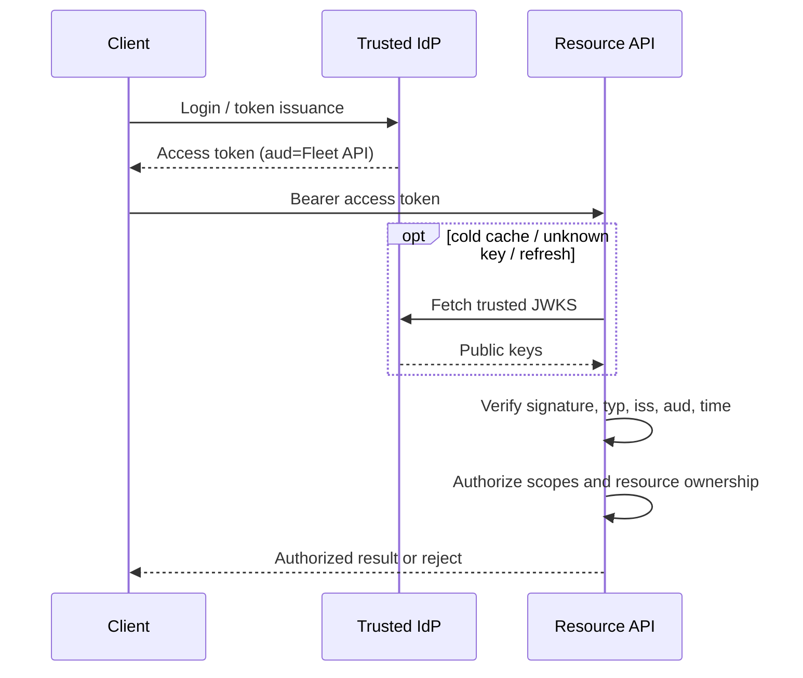

# CA-05 · Distributed IAM & security (P1)

## Казус

Fleet app има един login за AWS и GCP. Ако всеки resource server вика IdP за всяка заявка, outage на IdP или link спира и двата домейна. Ако приемаме JWT само по signature, може да приемем token за друг API или за друг issuer. Security е hard constraint, не optional fallback.

Лекция 15:30–21:00 и 23:40–24:55: central/federated SSO, independent technical identities, introspection vs local keys, compliance boundary. Допълваме с точен OAuth/OIDC contract, rotation и fail-closed.

Login/refresh still depends on IdP. Known cached key + valid unexpired token can work while IdP down; cold cache, unknown kid, refresh failure or expiry may fail. Cache TTL/key retention and bounded connect/read timeouts matter. Не прави fail-open при outage. Unknown issuer cannot choose arbitrary JWKS URI. При compromise rotation/revocation, short-lived tokens alone may be insufficient; use risk-based online checks or deny list with defined failure policy.

| Policy | Use / gain | Don't / cost | Evidence |
| --- | --- | --- | --- |
| Introspection (RFC 7662) | Opaque tokens or freshness of revocation policy | Per-request dependency/cost unless cached; caching delays revocation | Actual local 503 introspection test |
| JWT local validation | Signed access tokens, lower per-request dependency | No guaranteed immediate revocation; key distribution and expiry | [FleetJwtDecoder](lab/src/main/java/bg/hristomanov/education/cloud/FleetJwtDecoder.java), [JWT tests](lab/src/test/java/bg/hristomanov/education/cloud/CrossCloudJwtTest.java) |
| Federation/SSO | Unified user experience, issuer mapping | Central IdP/shared fate; account linkage review | Issuer-specific trust and account mapping test |
| Workload identity | Short-lived machine credentials, least privilege | No shared static cross-cloud secret; rotation/STS dependency | Test invalid audience/identity, deny policy |

**Token validation:** trust issuer & explicit JWKS endpoint, algorithm allowlist (RS256 example), token type (RFC 9068 access token profile), signature, audience, expiry, not-before, scope/role plus object-level authorization. ID token is for client login, not bearer API authorization. Signature validation alone insufficient. Mapping user roles across providers must not elevate privileges. Store external user identity as issuer + subject (within issuer context; pairwise subject may differ by client); account-linking only after verified proof/authorized workflow. Email alone is not stable unique ID; do not auto-merge accounts. See [OpenID Connect Core §5.7](https://openid.net/specs/openid-connect-core-1_0.html#ClaimStability).

Compliance: identify actual payment scope and applicable PCI DSS/GDPR requirements; segment card-data environment, inventory data/flows and verify isolation, access, logging, retention. A second cloud or subnet alone does not certify compliance; consult applicable assessor. Technical and user identities separate, no PII/tokens in telemetry. See [threat modeling](../../spring/security/threat-modeling/README.md).

Lab exercises: known key warmed, fail JWKS and introspection, expired/wrong aud/wrong issuer/wrong type/forged token, unknown key/rotation. Local loopback HTTP deliberately only in tests; production uses verified TLS. Existing [OAuth2/BFF/MCP](../../spring/security/bootiful-security/OAUTH2-BFF-MCP.md) covers login flow. This module tests decoder and introspector, not a full HTTP auth filter chain. Checklist: trusted issuer + audience; token type; least privilege; object ownership; key rollover overlap; outage fail-closed; independent identities.

## Оригинални източници

[Touret — Devoxx Poland 2026](https://www.youtube.com/watch?v=mOmuF5fDiUM) · [Touret — Part 2](https://blog.touret.info/2026/04/16/multi-cloud-from-the-trenches-part2/) · [Spring Security JWT](https://docs.spring.io/spring-security/reference/servlet/oauth2/resource-server/jwt.html) · [OpenID Connect Core §5.7](https://openid.net/specs/openid-connect-core-1_0.html#ClaimStability) · [RFC 9068](https://www.rfc-editor.org/rfc/rfc9068) · [RFC 7662](https://www.rfc-editor.org/rfc/rfc7662) · [Spring opaque token](https://docs.spring.io/spring-security/reference/servlet/oauth2/resource-server/opaque-token.html) · [Карта на evidence и ограниченията](SOURCES-AND-EVIDENCE.md)
