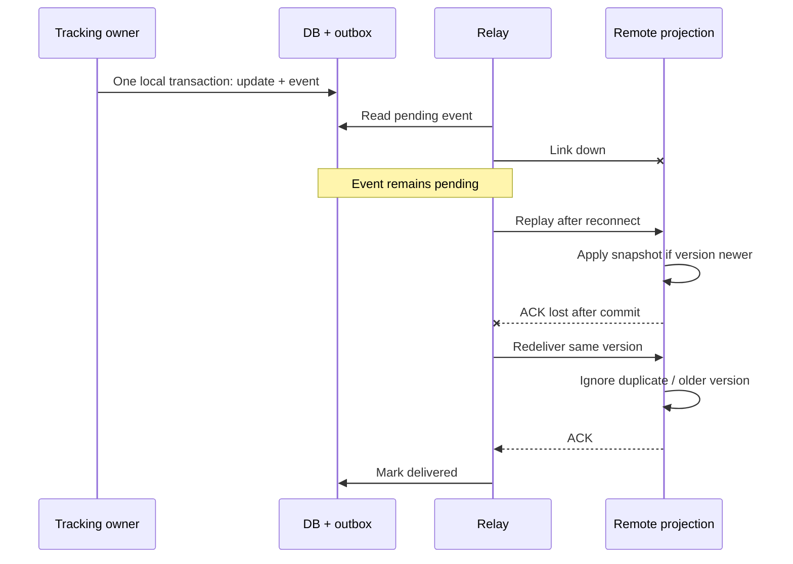

# CA-06 · Data ownership, synchronization & partition recovery (P1)

## Казус

Tracking owns vehicle location; customer owns subscription/payment; analytics needs both. Два services update една и съща location/cache и при network partition имат различна истина. Ако dual-write към DB и remote API, process може да падне между commits.

Лекция 21:00–24:35: source of truth, sync vs async, warning за bidirectional cache sync. Корекция: synchronous HTTP сам по себе си не гарантира consistency, async Kafka/CDC не гарантира zero loss. Гаранциите зависят от source durability, atomic publication, acknowledgment, ordering/replay и consumer transactions.

Only owner writes; read model stores version and tombstone. For full snapshots with monotonically increasing per-aggregate version, later snapshot subsumes older snapshots; reject/ignore duplicates & old versions. For delta events, skipping gaps loses data: ordered delivery or gap recovery required. Tombstone retention must exceed replay horizon; do not resurrect deleted item via stale event. Conflict same version with different contents → quarantine/error, not silent accept. Durable production outbox and projection+inbox transaction, CDC offsets, partitioning, retention, lag alerts, replay/reconciliation required. Bound backlog or stop admissions per business policy.

| Approach | Use / gain | Don't / cost | Evidence |
| --- | --- | --- | --- |
| Sync authoritative API | Immediate read, low rate; simple | Doesn't guarantee distributed atomicity; latency/availability | [CA-03](03-COMMUNICATION-RELIABILITY.md) |
| Read-through/cache-aside | Reduce repeated reads with stale policy | Never pretend cache is second authority; invalidation cost | [Caching](../../spring/caching/README.md) |
| Outbox + events/CDC | Local writes despite link failure, replay | Eventual consistency; lag, storage, duplicate handling | [Existing transactional outbox](../../spring/messaging/outbox-inbox/README.md), [CDC case](../../docs/case-studies/001-decathlon-kafka-business-table-cdc.md) |
| Multi-writer | Real requirement for writes in multiple partitions; explicit conflict model | Not for payment invariant or simple cache sync; no automatic global ordering | DR/consensus design and partition tests; not implemented here |

**Lab:** [FleetSynchronization](lab/src/main/java/bg/hristomanov/education/cloud/FleetSynchronization.java) models single-process atomic state+outbox, a bounded pending queue, link unavailable and lost ACK, per-vehicle versioned projection including delete. [Tests](lab/src/test/java/bg/hristomanov/education/cloud/FleetSynchronizationTest.java) verify no acknowledgement on unavailable link, idempotent replay, stale and conflicting version, tombstone and backlog bound. In-memory simulation loses state on process death, not proof of DB transaction durability. Real DB outbox/inbox tests remain canonical; no fake "exactly once" claim.

Checklist: explicit owner per fact; event ID/version; snapshot vs delta; atomic local commit; ack after consumer commit; retention/replay; PII deletion; bounded lag/backlog; no writes from projection.

## Оригинални източници

[Touret — Devoxx Poland 2026](https://www.youtube.com/watch?v=mOmuF5fDiUM) · [Touret — Part 2](https://blog.touret.info/2026/04/16/multi-cloud-from-the-trenches-part2/) · [AWS — transactional outbox](https://docs.aws.amazon.com/prescriptive-guidance/latest/cloud-design-patterns/transactional-outbox.html) · [Google Cloud — hybrid/multicloud patterns](https://docs.cloud.google.com/architecture/hybrid-multicloud-patterns-and-practices) · [Карта на evidence и ограниченията](SOURCES-AND-EVIDENCE.md)
