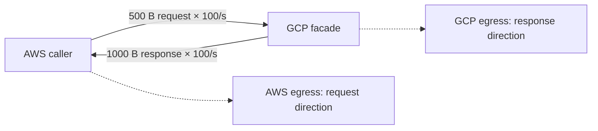

# CA-07 · Network costs & FinOps (P1)

## Казус

Customer API AWS sends query 100 times/s to GCP, with 500 B request and 1000 B response. Лекция 24:40–27:40 uses approx 260 GB/month and an illustrative internet vs dedicated connection quote. Не приемаме историческата цена като текуща оферта и не приемаме bandwidth като основание само по себе си за dedicated circuit.

30 days × 24 × 3600 = 2,592,000 s. At constant 100 RPS: 259,200,000 calls. Decimal units (1 GB=10^9 bytes):

| Direction | Payload bytes/month | Decimal GB |
| --- | ---: | ---: |
| AWS → GCP | 129,600,000,000 | 129.6 |
| GCP → AWS | 259,200,000,000 | 259.2 |
| Total | 388,800,000,000 | 388.8 |

260 GB is response direction only (rounded); not both directions. Payload throughput total ~1.2 Mbit/s average (0.4/0.8 directional), not a bandwidth sizing conclusion; peak, concurrency, headers/TLS, retry, replication and backup matter. GiB differs from GB. If traffic occurs only 8h/day or RPS is peak, integrate per interval instead of extrapolating peak. [CloudBudget](lab/src/main/java/bg/hristomanov/education/cloud/CloudBudget.java) and [numeric tests](lab/src/test/java/bg/hristomanov/education/cloud/CloudBudgetTest.java).

## Cost worksheet (hypothetical rates, not cloud pricing)

Assume for illustration AWS request egress 0.09 EUR/GB, GCP response 0.12 EUR/GB, 30 EUR fixed network charge, no ingress charge. 129.6×0.09 + 259.2×0.12 +30 = 72.768 EUR. 20% more calls via retries → 81.3216 EUR. If a second topology costs 300 EUR/month fixed and marginal 0.02 EUR/GB for both directions, compare fixed + variable; do not choose purely by transfer. Real invoices include tier, region, service, NAT/LB, VPN ports, taxes, discounts, free allowance, telemetry, replication, redundancy, staffing. Use current provider calculators and actual billing exports. Data transfer direction refers to sender; don't bill all bytes twice without tariff evidence.

## Decision matrix

| Option | When / benefit | When not / trade-off | Evidence |
| --- | --- | --- | --- |
| Public HTTPS / mTLS | Low-volume approved public endpoint with auth, egress control | Not if private link/compliance requirement; variable paths | Benchmark p95/p99, loss, route, security; actual cost |
| Encrypted VPN | Private address connectivity, moderate throughput; topology controls | Tunnel overhead, quotas, routing, HA complexity | Fail tunnel, test max packet/throughput and cost |
| Dedicated link | Proven capacity, predictable network, connectivity requirement | Not simply because two clouds; fixed cost, lead time, circuit diversity | Quote + redundancy/latency test |
| Reduce chatter / batch / projection | Cut cross-cloud requests and payload | Batch latency, freshness and storage cost | Count calls, compare cost per successful journey |

Co-locate regions when legal and feasible, but geographic closeness doesn't guarantee latency. Test end-to-end; for a 100 ms SLO allocate remaining budget per hop and measure distribution. Optimize cost per successful business outcome, not per token/VM alone. Simpler alternative: keep workload + data together. Checklist: directions/units; peak vs mean; retries; SLA/security; all-in cost and exit; p95/p99; dated prices. Non-runnable price exercise uses synthetic rates; executable arithmetic only.

## Оригинални източници

[Touret — Devoxx Poland 2026](https://www.youtube.com/watch?v=mOmuF5fDiUM) · [Touret — Part 2](https://blog.touret.info/2026/04/16/multi-cloud-from-the-trenches-part2/) · [Google Cloud network pricing](https://cloud.google.com/vpc/network-pricing) · [FinOps Foundation — unit economics](https://www.finops.org/framework/capabilities/unit-economics/) · [Карта на evidence и ограниченията](SOURCES-AND-EVIDENCE.md)
