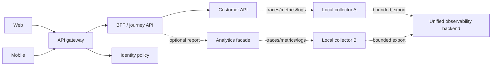

# CA-08 · Unified API, BFF & observability (P2)

## Казус

User sees AWS customer portal and GCP reporting API with incompatible errors and two login flows. Support cannot trace a request between clouds. Gateway can unify API surface but becomes another critical path and risk concentration.

Unified route, auth policy, versioning, correlation IDs and error contract. Gateway is not necessarily one physical instance, one region or one provider. BFF adapts screen/client needs, not domain logic or universal orchestration. Keep local resource authorization; never trust gateway alone. Gateway HA and DNS/TLS/config/IdP failure tested; define direct operational route with controlled access, not public auth bypass. Gateway also needs deadline, rate limits, payload limits and tenant isolation.

Telemetry: W3C trace context across trusted boundaries, correlation through messages, OpenTelemetry local collectors with bounded queues and sampling, local dashboards/alerts if central backend is down. Avoid PII, tokens, unbounded high-cardinality labels. Monitor end-to-end user SLI + service diagnostics (error rate, latency, saturation, link failures, lag, freshness, key refresh, egress). Logs/metrics/traces have differing semantics; don't "average percentiles" across clouds. Separate missing telemetry from healthy service. Export must not block the business request; measure dropped signals and retention. Central observability must not be a requirement for request success.

| Technique | When / gain | When not / cost | Evidence |
| --- | --- | --- | --- |
| API gateway | Shared external interface/routing/security | Not for simple internal module; extra hop, dependency | Gateway failover and contract tests |
| BFF | Distinct client needs and aggregation | Not for shared domain logic; multiple versions | Journey contract + optional degradation [CA-03](03-COMMUNICATION-RELIABILITY.md) |
| Unified OTel | Multi-team traceability and global SLI | Not raw unrestricted central PII; ingestion cost, backend outage | [Existing OTel demo](../../spring/observability/otel-agent-demo/README.md) plus cross-env exercise |

**Exercise (architecture note):** draw trace of payment success + report timeout. Define response with report status, correlation ID (not sensitive); inject telemetry endpoint failure; ensure no effect on request path, local alerts continue; describe verification against SLO. No collector deployment in new lab; reuse existing OTel lab. Checklist: unified experience, gateway redundancy, scoped auth, trace context, bounded export, local visibility, cost and privacy.

## Оригинални източници

[Touret — Devoxx Poland 2026](https://www.youtube.com/watch?v=mOmuF5fDiUM) · [Touret — Part 2](https://blog.touret.info/2026/04/16/multi-cloud-from-the-trenches-part2/) · [OpenTelemetry Collector deployment](https://opentelemetry.io/docs/collector/deploy/) · [Google Cloud hybrid/multicloud monitoring](https://docs.cloud.google.com/architecture/hybrid-and-multi-cloud-monitoring-and-logging-patterns?hl=en) · [W3C Trace Context](https://www.w3.org/TR/trace-context/) · [Карта на evidence и ограниченията](SOURCES-AND-EVIDENCE.md)
