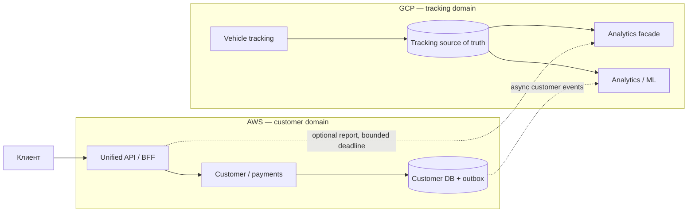

# Cloud Architecture — Resilience, Portability & Multi-Cloud Engineering

> P1/P2 · продължение на [System Design](../README.md). Основа: [Touret — Devoxx Poland 2026](https://www.youtube.com/watch?v=mOmuF5fDiUM), предоставен английски auto-generated SRT (~34 min), оригиналните слайдове и статии. Разграничаваме авторския казус от нашите корекции и учебни допълнения.

## Вход: платформа за автопарк

Клиентите следят автомобили, получават отчети, плащат и ползват прогнозна поддръжка. Една организация избира AWS за customer-facing/payment и Google Cloud за tracking/analytics/ML, за да използва подходящи managed services. Клиентът очаква един продукт, не два login-а и половин работещ dashboard. Ако API в AWS прави задължителна заявка към BigQuery за всяка операция, отказът, мрежовата латентност, API промяната и egress cost се пренасят през двата облака.

Първо проектираме business journeys, SLO/freshness, owners, legal boundaries и failure domains. Едва тогава избираме cloud, topology и transport. Не предполагаме, че много доставчици са задължителни.

Схемата е наша учебна адаптация, не копие на slide или задължителна topology. AWS пази customer/payment state, GCP — tracking data; отчетът може да е временно недостъпен или stale, но payment не зависи от analytics. Всеки failure path има отделен contract.

## Учебен ред

| ID | Глава | Evidence |
| --- | --- | --- |
| CA-01 / P1 | [Deployment strategies](01-DEPLOYMENT-STRATEGIES.md) | Decision matrix / architecture note |
| CA-02 / P1 | [Boundaries & exit strategy](02-BOUNDARIES-PORTABILITY.md) | Facade + dependency inventory |
| CA-03 / P1 | [Cross-cloud communication & availability](03-COMMUNICATION-RELIABILITY.md) | Local HTTP failure lab, availability model |
| CA-04 / P1 | [Disaster recovery & failover](04-DISASTER-RECOVERY.md) | DR tabletop + fencing/restore runbook |
| CA-05 / P1 | [Distributed IAM & security](05-DISTRIBUTED-IAM.md) | Spring Security signed JWT/JWKS + outage tests |
| CA-06 / P1 | [Data ownership & sync](06-DATA-OWNERSHIP.md) | Single-writer snapshot outbox/replay simulation |
| CA-07 / P1 | [Network costs & FinOps](07-NETWORK-FINOPS.md) | Directional arithmetic and sensitivity |
| CA-08 / P2 | [API gateway, BFF & observability](08-GATEWAY-OBSERVABILITY.md) | Journey failure / telemetry design exercise |

## README → код

- [Lab README](lab/README.md): команди, prerequisites, доказателства и ограничения.
- [Analytics client](lab/src/main/java/bg/hristomanov/education/cloud/AnalyticsClient.java), [Fleet dashboard](lab/src/main/java/bg/hristomanov/education/cloud/FleetDashboard.java), [HTTP outage tests](lab/src/test/java/bg/hristomanov/education/cloud/CrossCloudFailureTest.java).
- [JWT decoder](lab/src/main/java/bg/hristomanov/education/cloud/FleetJwtDecoder.java), [real signed token / loopback JWKS tests](lab/src/test/java/bg/hristomanov/education/cloud/CrossCloudJwtTest.java).
- [Fleet synchronization model](lab/src/main/java/bg/hristomanov/education/cloud/FleetSynchronization.java), [partition / replay tests](lab/src/test/java/bg/hristomanov/education/cloud/FleetSynchronizationTest.java).
- [Availability formulas and network budget](lab/src/main/java/bg/hristomanov/education/cloud/CloudBudget.java), [numeric tests](lab/src/test/java/bg/hristomanov/education/cloud/CloudBudgetTest.java).

Не са нужни AWS/GCP акаунти. Lab доказва локален HTTP failure и реална JWT проверка, но не cloud SLA, real multi-cloud failover, DB durability или pricing. За тях има отделни exercises и cross-links към съществуващи runnable модули.

## Изход

Можеш да обосновеш *дали* multi-cloud е нужен; да покажеш critical path, source of truth и trust boundaries; да сметнеш worst-case budget; да избереш най-простата DR стратегия; да различиш cached key от revoked token и replica от backup. Започни с [exercises](EXERCISES.md); [NotebookLM prompt](NOTEBOOKLM-PROMPT.md); [source register](SOURCES-AND-EVIDENCE.md). Няма автоматична оценка за усвоено знание.

## Оригинални източници

[Touret — Devoxx Poland 2026](https://www.youtube.com/watch?v=mOmuF5fDiUM) · [Google Cloud — hybrid/multicloud patterns](https://docs.cloud.google.com/architecture/hybrid-multicloud-patterns-and-practices) · [AWS — recovery strategies](https://docs.aws.amazon.com/wellarchitected/latest/framework/rel13-bp02.html) · [Touret — Part 1](https://blog.touret.info/2026/03/12/multi-cloud-from-the-trenches-part1/) · [Touret — Part 2](https://blog.touret.info/2026/04/16/multi-cloud-from-the-trenches-part2/) · [Карта на evidence и ограниченията](SOURCES-AND-EVIDENCE.md)
